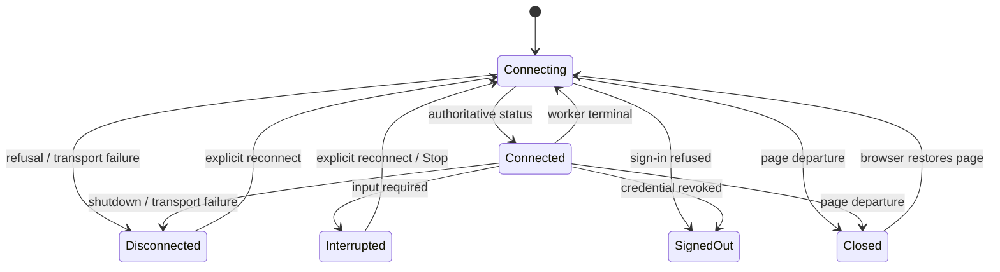

# Web module

## §web-host Hosting

An optional Agent Plugin declares one native Plurnk module. It uses the public
module lifecycle and HTTP registration seam, never a separate listener or process.
The daemon owns routing precedence, startup readiness and shutdown.

| Configuration | Behavior |
|---|---|
| PLURNK_WEB_ENABLED=1 | Claim and register `/` on the daemon's existing listener. |
| PLURNK_WEB_ENABLED=0 | Inert module: no route claims or registration. |
| Invalid value | Existing configuration diagnostic; no web module activation. |
| Package absent | No web routes. |

The package's .env.defaults owns the default. Installation is opt-in; the service
does not depend on this package. More-specific mounts retain their ownership.

## §web-assets Static resources

| Request | Response |
|---|---|
| GET `/` | Home document rendered from the packaged HTML; authenticated header controls follow {§web-page-shell}. |
| GET `/index.html` | Same root document. |
| GET `/assets/<build-generated-name>` | Compiled browser JavaScript and CSS. |
| GET `/manifest.webmanifest` | Web app manifest (`application/manifest+json`). |
| GET `/icons/plurnk.svg` | Scalable app icon. |
| GET `/icons/plurnk-maskable.svg` | Maskable app icon. |
| GET `/icons/NOTO-NOTICE.txt`, `/icons/APACHE-2.0.txt` | Artwork attribution and license. |
| GET `/vendor/OTM-LICENSE.txt`, `/vendor/PICO-LICENSE.txt`, `/vendor/DEPENDENCIES-LICENSE.txt` | Packaged substrate and bundled JavaScript dependency licenses. |
| HEAD on any served path | Same status and headers as GET, without a body. |
| Other asset path | 404 error document, never a home-page fallback or filesystem listing. |
| Asset method other than GET/HEAD | 405 with `Allow: GET, HEAD`. |

Query strings do not select assets. Paths select the build-generated asset inventory, never
filesystem paths derived from the request. Only packaged public assets are served;
configuration, source, credentials and workspace files are not public resources.
Assets are loaded during module startup: missing package bytes fail startup rather
than leaving a partially functioning page. Responses declare their media type,
byte length and `X-Content-Type-Options: nosniff`.

## §web-asset-encoding Static content encoding

| Boundary | Contract |
|---|---|
| Build | Retain each original asset. For non-HTML assets, package Brotli and gzip representations only when smaller than the original. The inventory names those representations; compression runs at build time, not startup or per request. |
| Address | All representations share the original URL and media type. Encoded files are inventory implementation details, not additional public URLs. Every declared representation must load before route registration. |
| Negotiation | Use standard `Accept-Encoding` negotiation, honoring quality weights, explicit exclusions, wildcards and identity. Among equally acceptable representations prefer the smallest. An absent or empty header selects identity; no acceptable representation yields 406. |
| Headers | Add `Accept-Encoding` to `Vary`, preserving existing fields; `Content-Encoding` only for encoded representations; `Content-Length` is the selected representation's byte length. HEAD selects the same representation and headers as GET but sends no body. No new cache lifetime is introduced. |
| Scope | Dynamic/private documents, authentication responses and other daemon mounts, including AG-UI streams, are not compressed by this handler. Their existing security, caching and streaming contracts remain unchanged. |

Reference: [HTTP content negotiation](https://www.rfc-editor.org/rfc/rfc9110.html#section-12.5.3).

## §web-index-documents Directory documents

| Request | Resolution |
|---|---|
| `/folder/` | The admitted `/folder/index.html` resource. |
| `/folder/index.html` | That same resource, with the same relative-link base. |
| `/` and `/index.html` | The root index document. |
| `/folder` | No implicit directory alias; links to directories include the final slash. |
| Missing index or child asset | 404, not an ancestor's index or the root document. |

Resolution uses the exact resource inventory, not a filesystem search or path
normalization. Query strings do not change the selected bytes. Production GET and
HEAD have the same status and headers; HEAD has no body. No redirect or history rewrite is
needed for the two index spellings. Native links, relative children, refresh and
back/forward work with JavaScript enabled or disabled. OTM does not intercept
document navigation; the server remains responsible for the document.

Production, Vite development and compiled preview share the same index-path
projection, applied before resource serving. Vite still owns HTML transformation,
compilation and HMR; no browser router is registered. Its development-only modules and
source serving are not production resources. Currently only the root document
is shipped by Vite. The daemon additionally renders the protected directories
below; worker assets remain unserved.

## §web-directory-addresses Named directory addresses

The directory codec maps names to origin-relative paths, not database IDs or
filesystem locations. It does not serve documents or authorize access.

| Directory | Generated path | Explicit document |
|---|---|---|
| Current unnamed daemon | `/~/` | `/~/index.html` |
| Workspace `~/ptl/project` | `/~/~/ptl/project/` | `/~/~/ptl/project/index.html` |
| Its worker `reviewer` | `/~/~/ptl/project@reviewer/` | `/~/~/ptl/project@reviewer/index.html` |
| Workspace `a@b`, worker `user` | `/~/a%40b@user/` | `/~/a%40b@user/index.html` |
| Workspace `index.html` | `/~/index.html/` | `/~/index.html/index.html` |

Workspace names are opaque, case-sensitive text. Encode each slash-separated
component with `encodeURIComponent`, preserving every slash, including leading,
repeated and trailing slashes. Encode the worker as one component. Raw `@` is the
worker delimiter: split it and the document suffix before decoding each name
exactly once. Literal `%2F` therefore becomes `%252F`, not a slash. Do not trim,
normalize Unicode, resolve names as paths, or interpret `~` as a home directory.

The parser accepts the folder and explicit-index spellings, percent-encoding
case variants and encoded equivalents of name characters (including `/`). `%7E`
is equivalent to the fixed `~` namespace marker. Query and fragment components
do not select a directory. Slashless directory aliases, malformed UTF-8/percent
escapes, empty names, multiple raw worker delimiters, worker child resources and
named-daemon prefixes are not directory matches. Parsing performs no lookups.

The daemon's [workspace name contract](https://github.com/plurnk/plurnk-service/blob/main/plurnk-core/SPEC.md)
admits nonempty well-formed Unicode without literal slash-delimited `.` or `..`
segments and reserves ASCII digit-only names for IDs. Admission does not rename existing
records: representable legacy names, including numeric names, retain their URLs.
The codec returns no path for an unrepresentable legacy name rather
than repairing it or substituting an ID; decoding an address to such a name is
also refused. Renaming changes its generated URL, not its identity or project
folder. No old-name redirect or filesystem exposure is implied.

This codec is verified using isolated native-document fixtures in production,
Vite development and preview. Live directory publication uses the daemon's
authentication contract.

## §web-session Browser sign-in

Web consumes the daemon's credential authority, never the operator's secret or
a second credential configuration. At setup it registers the confidential
client `plurnk-web` with callback path `/auth/callback` and scope `agui`. It asks
the published issuing face for the issuer of each request: the daemon's configured
public origin, else the address that request reached the daemon at. Its own calls to
the authority (discovery, code exchange, refresh) go to the face's answer for no
request, never to an address a browser named. No issuing face means the daemon has
explicitly disabled authentication; directory reads are then anonymous.

| Boundary | Contract |
|---|---|
| Authentication enabled, empty password | The authority shows configuration-required information and issues no browser sign-in, including on localhost. Web neither infers anonymous access nor adds a local bypass. |
| Authentication enabled, configured password | A browser signs in with `PLURNK_PASS` alone. No username field or web-owned identity configuration; a wrong password is refused by the authority at 401. |
| Authentication explicitly disabled | Anonymous directories; no Account or Sign Out controls. |
| GET `/auth/login?return=<page>` | Begin authorization code with PKCE S256 and a fresh state, bound to an HttpOnly browser cookie. Return locations are local directory addresses, `/account/` or `/account/sessions/` (also their explicit indexes); never an external URL. |
| GET `/auth/callback` | Consume the pending browser-bound state once; validate and exchange the code with client authentication. Issue a new authority `session` credential for the same subject, client, scopes and grant family, expiring with that grant's refresh credential. |
| Directory admission | Require a live authority-issued session for `plurnk-web` carrying `agui`; a bearer, refresh token, another client's cookie, or a revoked/expired session is not a web session. |
| POST `/auth/logout` | Require the issuer's exact Origin, revoke this browser's sign-in family and clear the web cookie. The authority sign-in and its module credentials end together; revisiting requires sign-in. Other browser sessions and independently authorized clients remain intact. |
| Concurrent callbacks | A new credential in the same sign-in family does not revoke that family. A genuinely different previous family is revoked. |
| Cookies | Host-only, HttpOnly, SameSite=Lax; Secure under HTTPS. Session path `/`, transaction path `/auth`. No browser storage or token in document content. |
| Request origin | A browser is answered at the address it reached the daemon by: its sign-in redirect, callback and Origin checks use the daemon's issuer for that request. No host is refused or redirected; forwarded headers are never read. |
| Failures | Invalid/replayed/mismatched callbacks fail without session issuance. Expiry/revocation requires sign-in again. Requests reveal no credential in diagnostics. |

Pending authorization state lives only in bounded, expiring module memory:
`PLURNK_WEB_LOGIN_TTL_SEC` and `PLURNK_WEB_LOGIN_PENDING` own its limits. Closing
the module clears it. Cookie and grant lifetimes come from the authority, not a
second lifetime setting. Sign-in uses the dependency-free MIT `oauth4webapi`
client and RFC 8414 discovery after listener admission; passwords are entered
only at the daemon's authorization endpoint.
Worker observation uses {§web-worker-observer}. Browser access credentials use
{§web-access-token}; they are never embedded in documents.

References: [OAuth browser applications](https://www.rfc-editor.org/rfc/rfc10017.html#section-6.2),
[OAuth security best practice](https://www.rfc-editor.org/rfc/rfc9700.html).

## §web-access-token Browser access credentials

The module is an OAuth token-mediating backend, not a second issuer. It retains
the authorization-code grant's access and refresh credentials in daemon memory,
keyed by the authority's sign-in family. The authority still owns admission,
identity, expiry, revocation and the account inventory.

| Boundary | Contract |
|---|---|
| POST `/auth/token` | Require a live web session and the issuer's exact Origin. Return only `access_token`, `token_type: Bearer`, and remaining `expires_in` seconds as no-store JSON. Other methods are 405; disabled authentication leaves the endpoint absent (404). No cross-origin access or credential-bearing redirect. |
| Access expiry | Reuse a still-valid access credential; otherwise perform the standard OAuth refresh grant with confidential-client authentication. Concurrent requests in the same family share one refresh, so rotation does not race across tabs. |
| Grant integrity | Access and refresh credentials must belong to the registered client, subject, scope and family. A refresh cannot change the family or resurrect a revoked sign-in. Failed refreshes are surfaced; no operation is replayed or authority substituted. |
| Revocation and cleanup | Authority revocation releases the retained grant. Expired grants are pruned on subsequent credential activity; module close releases them and its revocation subscription. Session expiry remains fixed by sign-in, not extended by refresh. |
| Browser custody | Access credentials are for the same-origin `/agui` endpoints and live only in JavaScript memory. Refresh credentials and client authentication never leave the server; no local/session storage, URL, document or diagnostic contains them. |
| Refusals | Missing/expired/revoked sign-in is 401; wrong/missing Origin is 403. Expected endpoint failures use RFC 9457 JSON, not an HTML sign-in redirect. |

Worker observation consumes this primitive under {§web-worker-observer}; it adds no
persistent browser state or additional session registry.

## §web-authorization-style Authorization document presentation

| Boundary | Contract |
|---|---|
| Registration | At setup the module registers the single stylesheet declared in the compiled document's head as its client's `stylesheetPath`, verifying its presence in the asset inventory. Missing or multiple document stylesheets are build-contract faults. Lazy content-renderer styles are independent assets, never authorization-page dependencies; no alias route or theme setting is added. |
| Document ownership | The authority owns sign-in, setup/error, consent and session documents, credential validation and security policy. Web supplies neither a form nor an HTML rewrite. The authority selects the stylesheet from the trusted client registration, never arbitrary request input. |
| Presentation | The same Pico Classless Green, monospace, 65ch measure, light/dark colors, native controls and article cards apply to authorization and web documents. Ordinary authorization pages work without JavaScript. |
| Production pruning | The public `authorizationDocumentSpecimens()` export from `@plurnk/plurnk-agui` supplies the authority's markup to PurgeCSS. No copied templates or private daemon-source scan. This is a development dependency, not a browser/runtime import. |

The daemon's standalone documents remain its own responsibility when no registered
module stylesheet applies. Browser coverage exercises the installed module and
authority together, including empty/wrong passwords and signed-out re-entry.

## §web-account Account and sign-ins

| Surface | Contract |
|---|---|
| GET/HEAD `/account/` or `/account/index.html` | Protected Pico article containing native navigation to Sessions. No displayed internal subject, fictional profile or inline session inventory. |
| GET/HEAD `/account/sessions/` or `/account/sessions/index.html` | Protected Pico article with Account breadcrumb and a native table of the authenticated subject's live sign-ins from `credentials.sessions(subject)`. No independent inventory. Table overflow stays inside its figure on narrow screens. |
| Each sign-in | Authority-issued creation/expiry times and client names; mark the family of the presented web session as “This session”. Do not invent device identity or last activity. Family handles are not credentials. |
| POST `/account/sessions/<family>/revoke` | Require a live web session and the issuer's exact Origin; revoke only a family in that subject's live inventory. A missing or foreign handle is 404. Revoking this session also clears the web cookie and returns home; otherwise redirect to Sessions. |
| POST `/account/sessions/revoke-others` | Same admission and Origin check; revoke all listed families except this session, then redirect to Sessions. |
| Expired/revoked credentials | Protected GET requires sign-in again; a submitted action fails at 401 rather than silently authenticating and replaying it. |
| Explicit anonymous posture | Account documents and actions are absent (404); no fictional account. |

Forms work with JavaScript enabled or disabled. Read and mutation responses use
the private headers in {§web-directory-documents}; GET never revokes anything.
Revocation does not mutate workers, workspace ownership or independently authorized
client credentials. The daemon owns credential lifetime, grouping and revocation.

## §web-directory-documents Read-only directory documents

| Document | Content / lookup |
|---|---|
| `/` | Public foundation document and a real link to `/~/`. |
| `/~/` | `listWorkspaces()`: an HTML `ul/li/a` list of exact names. Prefix each name with ☁️ when `project_root` is null, otherwise 📁; accessible image labels identify folderless/project workspaces. Never infer folder presence from the name. |
| Workspace directory | Exact-name lookup in `listWorkspaces()`, then folder presentation under {§web-workspace-folder} and one `listWorkers(id)` census rendered under {§web-worker-directory}. |
| Worker directory | Exact-name model-worker lookup; identity, breadcrumbs and actual parent under {§web-worker-directory}, plus passive status under {§web-worker-observer} and conversation under {§web-worker-conversation}. |
| Missing workspace/worker | 404; never create, attach, claim ownership, start a loop or infer a project folder. |
| Unrepresentable legacy name | Escaped text without a link; no renamed display, ID substitution or broken generated URL. |

Every directory (including a missing one) is authenticated before data lookup.
GET and HEAD have matching status/headers; HEAD has no body. Documents and auth
responses are `Cache-Control: no-store`, suppress referrers, prevent framing and
use same-origin scripts, styles and forms. Names are escaped as text/attribute
values; never executable HTML or filesystem paths. Ordinary navigation and
logout use native links/forms with JavaScript enabled or disabled. Rendering
reuses the compiled root document's head, styles, icons and OTM boot; no browser
router, client-side list fetch, duplicate English dictionary or extra UI library.

Vite development/preview continue to serve frontend documents only: dynamic
directory/auth routes require a daemon. The installation gate accepts explicitly
supplied published or candidate platform archives to verify the public contract.

## §web-workspace-folder Workspace and folder labels

Compare the workspace name with the daemon's `project_label` by exact equality.
Render that label as escaped text, never a filesystem link. Do not derive a label
from `project_root`, the browser's location, the client's home or the workspace name.
The daemon owns home abbreviation; names remain opaque and unchanged.

| Workspace page | Breadcrumb | Separate folder line before the worker list |
|---|---|---|
| Folderless (`project_label: null`) | ☁️ name | None. |
| Name equals folder label | 📁 name | None; the breadcrumb already identifies the folder. |
| Name differs from folder label | ☁️ name | 📁 followed by the supplied label. |

The workspace index continues to mark folder presence under
{§web-directory-documents}, irrespective of name equality. Accessible icon labels
distinguish the workspace identity from its project folder; a cloud on a named
workspace with a separate folder must not claim it is folderless.

## §web-worker-directory Model-worker navigation

| Boundary | Representation |
|---|---|
| Membership | Every `origin: model` worker appears once, regardless of owner, lifecycle or name spelling. The runtime bookkeeping worker has no directory row or worker page; its direct page URL returns 404. This is presentation, not an access policy for daemon APIs. |
| Roots | Model workers with `parentWorkerId: null` form the primary list. |
| Children | Immediate model children nest beneath their actual model parent. Preserve daemon order among siblings. |
| Background | Model workers with an immediate non-model parent begin branches in one collapsed “Background work” section. Omit it when empty. No A2A-specific classification or reparenting. |
| Disclosure | Native nested `ul/li` lists. Each name is a real link; a separate `details/summary` shows the direct model-child count. Initially collapsed; leaves have no disclosure. Link navigation and disclosure are separate keyboard/pointer actions, including without JavaScript. |
| Parent on worker page | Show the actual parent's name: a link for a model parent, escaped text for a bookkeeping parent. Roots omit the parent line. URL breadcrumbs remain workspace/worker navigation, not invented lineage paths. |
| Integrity | Duplicate identities, absent referenced parents and cyclic model parentage are internal contract failures; never silently omit or invent workers. |

Rendering and expansion perform no attachment, inference, ownership change or
daemon mutation. There is no browser topology cache, saved expansion state,
lazy branch request, custom tree role or JavaScript disclosure handler. Opening a
worker page may observe it under {§web-worker-observer}, never control it.

## §web-worker-observer Read-only worker status

The server renders a semantic status section only for an existing model worker,
with the daemon's qualified thread identity (`<workspace ID>#<worker name>`) and
whether access requires a browser session. URLs and breadcrumbs retain readable names;
renaming a workspace does not redirect an already-open observation to another worker.
No credential appears in the document. JavaScript enhances that section; other
pages neither load HttpAgent nor request access credentials or AG-UI streams.
Without JavaScript the identity and navigation remain usable, with an explicit
notice that live status requires JavaScript.

| Boundary | Contract |
|---|---|
| Transport | A fresh official HttpAgent via its public connection hook, using `/agui/connect` and the qualified `threadId` supplied by the document. Empty messages/tools; no forwarded workspace, action, resume, control claim or capability replacement. SDK owns event parsing, replay and state patches; each attachment rediscovers current conversation and interrupt continuations. |
| Credentials | Before each connection, use {§web-access-token}; explicitly anonymous documents send no Authorization header and never call `/auth/token`. An admitted stream outlives access expiry. Credentials live only in the active request/SDK instance and are released on departure. |
| Continuity | Standard successful/cancelled `RUN_FINISHED`, or `RUN_ERROR` carrying a worker terminal in `metadata.plurnk.terminal`, identifies worker completion; reconnect passively to watch subsequent work. A protocol/credential failure stops observation. An interrupt stops delivery with an explicit input-required notice under {§web-worker-input}. Never retry work or infer completion from transport closure. |
| Disconnection | Transport/protocol failure, admission refusal, or daemon shutdown stops reconnection. Show a Pico error card, retain clearly stale last-observed values, and offer a native Reconnect form. Its enhanced submission reattaches without navigation, preserving the draft; it never resubmits input. A revoked/expired browser session offers native sign-in instead. No background polling or retry/backoff system. |
| Page lifetime | `pagehide` closes the observation and stops local timers without cancelling the worker. A restored page opens a fresh observation. Hidden tabs do not claim or cancel work. |
| Projection | `plurnk.status` is authoritative for lifecycle, latest loop, packet count and spend. Usage/cost cover the worker and descendants; absent values read “Unknown”, not zero or a known subtotal presented as a total. The browser keeps no accounting ledger or transcript cache. |
| Elapsed | Measure the latest loop from daemon `claimedAt` to `terminatedAt`, or the current clock while connected. Update seconds locally; freeze on disconnect. No claim time means unknown. Local clock arithmetic never changes daemon lifecycle or accounting. |
| Presentation | Native definition list and OTM text/state projection, ordinary light/dark Pico styling, no application classes or imperative styling. Connection status and errors are announced; the ticking elapsed value is not a live announcement. |

Opening the page remains passive. Message submission and explicit cancellation
belong to {§web-worker-input}; neither is a consequence of observation.

## §web-worker-input Message composer and explicit Stop

| Boundary | Contract |
|---|---|
| Document | A document-owned OTM template supplies a labelled native textarea, Send form and separate Stop form. JavaScript mounts them only on worker pages. Native multiline editing, validation, focus and Pico presentation; no keyboard shortcut, attachment picker, forced scrolling or chat layout. |
| Send | Submit exact nonblank text as one standard user message to `/agui`, on the document's qualified thread. New text gets a new ID; a deliberate retry of the same unconfirmed draft retains its ID for daemon idempotency. Only explicit submission attaches control. Declare an attended client and no unimplemented tools; server permissions remain unchanged. |
| Handoff | One current HttpAgent owns the displayed messages. Close and await the preceding delivery before using its received history for a message Run; passive reattachment starts fresh under {§web-worker-observer}, not with obsolete interrupt continuations. Follow-ups during live work use the same ordinary message admission; no parallel transcript, injection endpoint, automatic retry or offline queue. |
| Admission | The daemon's `status.inbox`, user-message snapshot or user-message arrival confirms acceptance by message ID; local SDK insertion never does. Acceptance precedes model observation: queued follow-ups remain discoverable during inference, after reconnect and after cancellation before observation. Their eventual arrival retains the same ID and does not repeat text. |
| Draft | Prevent another submission until acceptance or explicit rediscovery after a failed delivery. Clear the submitted text only if the textarea still contains it, preserving newer typing. A refusal or uncertain connection failure retains the draft, explains uncertainty and requires explicit reconnection before another submission. Reattachment may confirm acceptance; absence is not proof of refusal, so a deliberate unchanged retry retains its idempotency key. No automatic resend, browser persistence or guarantee across full reloads is implied. |
| Stop | Explicit submission invokes public `loop.cancel` for the same thread through an independent management Run, with no conversation messages. Its acknowledgement requests cancellation; only worker status/terminal events establish the outcome. Stop preserves unsent text, targets no unrelated worker, and is unavailable without known live work. A pending follow-up does not prevent stopping already-running work. |
| Interrupt | Retain the SDK's pending interrupt and call evidence, stop automatic observation, and explain that this page cannot answer approvals or interactions yet. Send is unavailable until rediscovery or settlement; explicit Stop remains available for live work on this worker. Never synthesize a decision or advertise an unimplemented question tool. |
| Failure and departure | Request failure is visible, never a successful send or cancellation. Refresh, navigation, page close and delivery handoff only release browser resources: they cannot cancel admitted work. No message or cancellation is automatically resubmitted after reconnect. |

## §web-worker-conversation Conversation projection

| Boundary | Contract |
|---|---|
| Authority | The worker HttpAgent's ordered `messages` collection supplies the conversation. No CUSTOM-row reconstruction, second transcript store, browser persistence or event parser. Observation submits no input and never answers a tool call; authored input follows {§web-worker-input}. |
| Identity | One OTM template instance per message ID, in SDK order. Snapshots replace membership and order; streaming changes update the existing instance. Unchanged bodies and native disclosure state survive updates and passive reconnections. Rendered-node lookup comes from the DOM; a per-outlet last-render cache avoids replacing unchanged Markdown, but holds no separate message collection. A page reload reads fresh authority state, not browser history. |
| User and assistant | Role-labelled semantic articles, with optional supplied author name. Text is rendered as Markdown. Assistant calls remain attached to their containing message. Empty content does not imply a fabricated answer. |
| Reasoning | A native disclosure in message order, initially collapsed. Its Markdown body remains readable; no automatic opening, forced scrolling or repeated live-region announcements. |
| Calls and results | Native disclosures show the exact function name and argument text. Each result retains its place in the sequence and links to its call using `toolCallId` when present in the collection. Results and activity payloads are literal, inspectable data, not executable instructions or application state. Standard tool errors are shown alongside any partial content. |
| Working notes | NOTE calls follow {§web-working-notes}; they remain calls, not answers or provider reasoning. |
| Other messages | System/developer messages and structured activity remain labelled disclosures. Non-text content parts remain inspectable in their original order; this slice adds no inline media player, download action or attachment service. Subagent invocation IDs remain visible as attribution, not mistaken for the parent's output. |
| Layout | Native ordered list, articles, details/summary, code and preformatted data, using Pico and the existing four CSS layers. No duplicate worker heading, chat bubbles, application classes or virtual-DOM framework. Long code, tables and payloads scroll within their content region on narrow screens. |
| Connection | The existing connection notice governs whether displayed history is live. An empty collection says “No messages.”; a transport failure is never presented as an empty or successfully completed conversation. |

## §web-conversation-content Untrusted message content

| Boundary | Contract |
|---|---|
| Markdown | Marked parses ordinary text, code, links, lists and tables. Raw HTML is escaped. Authored images become links rather than automatic network requests. Tables have native figure containers. Mermaid follows {§web-diagram-content}; no syntax highlighter or embedded application is implied. Malformed fences follow the parser's ordinary Markdown semantics, without operation-style recovery or inferred intent. Math follows {§web-math-content}. |
| DOM admission | DOMPurify sanitizes the generated HTML into a fragment before insertion. Only Markdown presentation elements and their necessary attributes are admitted; no application data attributes, IDs, styles, scripts, forms, frames, SVG or active controls. GFM task checkboxes remain disabled. Links use the sanitizer's URI checks; no model-supplied HTML bypasses sanitization. |
| Ownership | Markdown owns only its content outlet. OTM owns message structure and scoped application state; rendered content cannot become an OTM binding or mutate navigation, credentials or controls. Sanitized fragments are inserted directly; only recognized math and diagram outlets receive their bounded enhancements. |
| Continuity | The same admission boundary applies to every rich-text role and NOTE body, including partial updates and replay. Message identities, author/category labels, call arguments, errors and structured payloads remain data, never markup. Rendering performs no model-directed navigation or resource request; ordinary links require user activation. |
| Build | Parser and sanitizer are bundled only with the worker entry and include their licenses. The allowed Markdown elements participate in CSS pruning so production preserves their Pico presentation. Math code and its vendor stylesheet load only when a recognized formula occurs; fonts are requested by the renderer's CSS when needed. Diagram code loads only for recognized Mermaid blocks. Renderer-owned selectors survive pruning. All assets and licenses are locally packaged. |

## §web-working-notes Inspectable working material

A standard call whose function name and `metadata.plurnk.op` are both `NOTE`
may present its string `body` as sanitized Markdown inside its initially
collapsed disclosure. The optional string `aside` labels the note beside its
name; no body preview or automatic expansion promotes working material to an
answer. Exact argument text remains available in a nested native disclosure.
Incomplete JSON, non-object arguments, non-string bodies or invalid asides retain
the ordinary literal call presentation, without repair or inferred content.

The enclosing assistant message, call identity, attribution and correlated result
remain in the SDK's order and roles. Changes to argument shape preserve the
call's disclosure state; unchanged bodies retain their nodes and selection.
Generic tool calls and results do not acquire Markdown interpretation from their
name or content. This presentation adds no conversation store or protocol role.

## §web-math-content Native mathematics

| Boundary | Contract |
|---|---|
| Delimiters | Marked extensions recognize `$…$`, `$$…$$`, `\(…\)` and `\[…\]` outside inline/fenced/indented code. Single-dollar math stays on one line, has no whitespace immediately inside either delimiter, and cannot end immediately before a digit; ordinary currency such as `$50 and $100` remains text. Escaped delimiters remain literal. Block forms can span lines. |
| Interpretation | Temml's public DOM renderer produces native MathML, with an annotation retaining the TeX source. No TeX document engine, cross-expression macro state, global equation numbering or browser-specific renderer. |
| Admission | Untrusted mode rejects TeX HTML/media/link extensions. DOMPurify sanitizes renderer-owned DOM in place, without serializing styles back through HTML. Renderer-required classes and layout styles remain inside this content boundary; IDs, navigation attributes and application bindings do not. The Markdown allowlist is not widened to accept authored MathML or HTML. |
| Failure and streaming | Incomplete delimiters stay text. Unsupported/malformed complete formulas retain their exact delimited source with a concise local error. The source remains readable while the renderer loads or if loading fails. Detached outlets cannot overwrite a newer message. Unchanged bodies retain their existing MathML and native selection. Unexpected implementation failures remain diagnostics, not concealed parse errors. |

## §web-diagram-content Static diagram images

| Boundary | Contract |
|---|---|
| Recognition | Marked code blocks whose first language word is `mermaid` (case-insensitive) are eligible. Inline code, indented code and nested fenced examples retain ordinary Markdown meaning. No inferred fence repair, orientation rewrite or alternate parser. |
| Interpretation | The locally bundled `beautiful-mermaid` public SVG renderer supports its flowchart, state, sequence, class, ER and XY syntax subset. Use its standalone appearance, not an application theme system. No DOM-dependent Mermaid runtime, server rendering endpoint or headless browser. |
| Image boundary | Generated SVG becomes a data-URI source of a native `img` in a document-owned OTM template. Never insert SVG markup into the application DOM or an embedded document. Native SVG image restrictions prevent scripts and external resource loading, including renderer font imports; the application CSP is unchanged. Authored Markdown images and raw SVG receive no new permission. |
| Source and failure | Source remains readable while the module loads. A successful image has an accessible label and an adjacent native source disclosure. Unsupported syntax or rendering/decoding failure retains the source with a concise local diagnostic and the original error available as its title. A failed module load also reports the original browser error. No rewriting, alternate renderer or automatic retry. |
| Continuity | Detached outlets cannot publish a late image into a newer message. Unchanged bodies retain their image and native source-disclosure state. Diagrams are static presentation, not interactive links or controls; the image/source boundary applies to every rich-text role and NOTE body. |
| Viewport | Keep intrinsic diagram dimensions and browser zoom. Wide images scroll inside their own viewport without shrinking labels or widening the whole page; source remains selectable text. |

Reference: [SVG image restrictions](https://developer.mozilla.org/en-US/docs/Web/SVG/Guides/SVG_as_an_image#restrictions).

## §web-content-reflow Constrained and changing viewports

Ordinary prose and controls reflow at 320 CSS pixels without page-wide horizontal
scrolling. Code, tables, formulas and diagrams that intrinsically require two dimensions
scroll within their own content boundary, not the whole message. Keep readable
font sizes and native zoom; do not shrink content or rewrite diagram orientation.
Native document flow responds to viewport changes without a JavaScript layout
controller, fixed-height conversation pane or forced scrolling. Browser rendering
limitations do not introduce a second renderer or compatibility polyfill.

## §web-page-shell Native page shell

| Surface | Contract |
|---|---|
| Shared navigation | Home/brand and Workspaces are real links preceding the single `main` landmark; no skip-navigation control. Authenticated documents add Account and a compact secondary Sign Out POST form in the header; no footer logout. Anonymous documents omit account/session controls. Native links and controls retain visible keyboard focus. |
| Header actions | Mascot-only home link with accessible Plurnk name; 📁 Workspaces, ⚙️ Account, ✖ Sign out: icon-only controls with explicit accessible names and native explanatory titles. Brand and actions align in one horizontal row, including narrow viewports. Breadcrumbs retain text labels. |
| Breadcrumb layout | One native breadcrumb in the header, between mascot and menu when its intrinsic width fits; otherwise centered directly below both. Names can wrap within the lower row, never clipped or abbreviated. Content, font size and available controls determine fit, not a viewport breakpoint or JavaScript measurements. Keyboard order remains mascot, menu, breadcrumb. |
| Document title | Home: `Plurnk`. Directory/error: its identity or HTTP status followed by ` — Plurnk`. Home and directory pages omit duplicate headings; the breadcrumb identifies the current worker. Account and error pages retain one `h1`. |
| Directory breadcrumbs | Workspaces → whole workspace name → worker; only applicable ancestors appear. The current item is text marked `aria-current="page"`. The workspace-page marker follows {§web-workspace-folder}. Slashes in names do not invent intermediate directories. |
| Empty lists | “No workspaces.” or “No workers.”; no empty list masquerading as content. |
| Page width | Non-worker documents are centered and bounded by 65ch or the viewport, whichever is narrower. Worker documents and their navigation use the available viewport width. Gutters and wrapping preserve narrow-screen usability and complete names. |
| Expected HTTP failures | A Pico `article` card within the same HTML shell: heading, decorative warning emoji, escaped explanation and native Home link. Preserve status/Allow/HEAD semantics and private headers from {§web-directory-documents}. Do not echo URLs, credentials or internal exceptions. Unknown internal failures still propagate to the host. |

The compiled root document owns shared navigation and assets, including an inert
template for authenticated navigation. OTM's documented indirect-template marker
identifies its server-owned instantiation. Server rendering selects that template
and supplies the title, header breadcrumb and main content. Ordinary navigation, focus, lists and forms work without JavaScript;
there is no browser-owned route or session inventory.

## §web-document Document

The home document contains only the shared navigation and an empty main landmark;
it initializes OTM from locally packaged ES modules. Locally packaged Pico Classless Green styles semantic elements
without application classes. Brand green is `#148800`; dark-mode link colors remain
bright enough for contrast. Native color-scheme selection is preserved; typography
uses Pico's system monospace stack. Content and styling
work without JavaScript.
There is no theme switcher, client routing, persistent browser storage, external
asset request. The root links to the directory index. Protected
directory documents supply daemon identities as escaped HTML, never credentials.

Source stylesheets load in this order, with one concern per file. Production
compilation may combine them without changing their cascade:

| File | Responsibility |
|---|---|
| `app-vendor.css` | Unmodified pinned Pico Classless Green, copied during build. |
| `app-structure.css` | Readable page width, gutters and wrapping. |
| `app-style.css` | Presentation through substrate tokens; brand accents and system monospace. |
| `app-state.css` | Worker page width, observer connection/error presentation and native focus visibility. |

## §web-language Source language

The shipped document is English, declared by `html[lang]`. Its readable source
text remains in HTML; `data-i18n` keys identify text rather than appearing in its
place. OTM boot explicitly uses the document language and opts into no persistent
state. Browser language, query parameters and unrelated stored preferences do not
select an unshipped translation. No translation endpoint or duplicate source
dictionary is declared or packaged. Boot neither fetches a dictionary nor
rewrites the document into English, and completes without accessing browser
storage even when storage is denied. No language picker or additional locale is shipped.

## §web-authoring Browser boundaries

| Concern | Owner |
|---|---|
| Document structure and ordinary navigation | Semantic HTML, real links, lists and native forms; not a JavaScript-created application shell. |
| Interactive worker | JavaScript-dependent product surface, not a parallel no-JS implementation. Status, conversation and explicit input use {§web-worker-observer}, {§web-worker-conversation} and {§web-worker-input}. |
| Browser mechanisms | OTM public APIs and native controls; reusable gaps are repaired upstream rather than through local shims. |
| Visual state | Native element state or semantic attributes projected through CSS; no imperative style mutation. |
| Static checks | OTM HTML, JavaScript and CSS rules, unsafe-HTML sink checks, and separate browser/server JavaScript type checks. Browser code consumes the public client types with DOM libraries and no Node globals; the application port remains server-only. |

## §web-browser-security Browser execution and diagnostics

| Boundary | Contract |
|---|---|
| Scripts and styles | Same-origin resources only; no inline execution or dynamic code generation. Browser schema validation runs without JIT, configured before SDK schema initialization. |
| Images | Same-origin and data-URI images, including Pico's embedded SVG controls. This permission does not extend to scripts, styles or connections. |
| Other directives | Default same-origin; no objects, base URL changes or framing. Forms submit to the same origin. |
| Browser gate | Capture console warnings/errors and uncaught exceptions from document, authentication, directory, SDK and actual worker journeys. Healthy paths produce none. Negative cases assert their specific expected diagnostics; no blanket filtering of CSP or SDK errors. |
| Content checks | Adversarial compiled-renderer tests exercise HTML/SVG, executable URL schemes, application-binding injection, literal fields, streaming and replay in Chromium, Firefox and WebKit. Assert preserved application structure, inert rejected links, no model-directed requests or new browsing contexts, and clean diagnostics. Math additionally exercises untrusted extensions, macro isolation and delayed rendering. A packed authenticated worker receives hostile NOTE and answer bodies through real SDK delivery and refresh. These checks verify concrete cases, not a claim of exhaustive security assurance. |

## §web-contract-checks Specification gate

The web lint gate uses the shared `@plurnk/plurnk-spec-check` development tool.
Named declarations are unique, citations resolve, and each contract has a
non-prose witness. No unwitnessed-contract allowance is used. The gate works from
a standalone checkout with installed dependencies, without a neighboring service
checkout. This checks traceability, not whether a cited test proves its contract.

## §web-build Development and production

| Command | Contract |
|---|---|
| `npm run dev` | Prepare static assets, then serve `web/` through Vite on loopback with HTML reload and CSS hot updates. No daemon or model is started. |
| `npm run build` | Prepare assets, clean and compile into `ai.plurnk/dist/`, then generate `ai.plurnk/assets.json` from the complete output. |
| `npm run preview` | Locally preview the last build through Vite; not a production server. |
| Daemon startup | Load the inventory and every listed production asset; serve them through the plugin's existing mount. No Vite runtime or development server. |

`web/index.html` owns the document, `web/app.js` imports OTM's npm entry,
and `web/public/` supplies unchanged public assets. The four CSS source
concerns remain under `web/styles/`. Generated output is packed, not committed.
Production contains no development-client injection, frontend sources, or source maps.
Current stable browsers are the supported platform. Compile native modern syntax;
do not add legacy browser transforms or a module-preload polyfill.
Development serves readable, complete Pico Classless Green. A CSS import entry
composes all four layers before production pruning. PostCSS/PurgeCSS scans the
browser source and server document renderer, preserves browser pseudo-states and
ARIA/role/data-driven states, and removes unused rules, variables and keyframes.
Vite then minifies the result. Browser coverage verifies the compiled presentation,
including error cards, native controls, light/dark mode and narrow viewports.
The current development page has no backend interaction; no API proxy is installed.

## §web-installation App identity and installation

| Surface | Contract |
|---|---|
| Manifest | Stable origin-relative `id`, `start_url` and `scope` of `/`; Plurnk name, English description, `standalone` display, no orientation lock. |
| Identity | Brand green `#148800`; Google Noto hamster SVG with glasses and a green bow, retaining Apache-2.0 licensing and modification attribution. |
| Icons | One SVG for the document, favicon and manifest; no raster fallback. A generated opaque, full-bleed maskable SVG places artwork inside the safe circle (40% of image width). Both manifest entries declare `sizes: any`. |
| Document metadata | UTF-8, language, zoomable viewport, description, application name, early `color-scheme: light dark` and brand theme color. The standard manifest owns standalone launch; no legacy platform-specific launch metadata. |
| Privacy | Discourage indexing with `noindex, nofollow`; limit referrers to the same origin. No external fonts, analytics or deployment-specific canonical URL. |
| Installation | Browser-owned installation and standalone launch. HTTPS is required remotely; localhost/loopback is eligible without TLS. Browser and OS support varies. |
| Availability | Requires the daemon. No service worker, offline cache, background sync, notifications or claim of offline functionality. |

Installation metadata does not create a second server or change ownership of
`/agui` or other daemon mounts. No in-page install prompt or application UI is added.

References: [installability](https://developer.mozilla.org/en-US/docs/Web/Progressive_web_apps/Guides/Making_PWAs_installable),
[manifest icons](https://developer.mozilla.org/en-US/docs/Web/Progressive_web_apps/Manifest/Reference/icons).

## §web-package Package boundary

The npm archive includes the Agent Plugin manifest, native module, defaults,
document and its complete browser dependency graph, including OTM, Pico, HttpAgent and artwork licenses.
Tests and build tooling are not runtime inputs. Verification installs the archive
beside candidate service archives in an isolated environment and exercises actual module
discovery, routing and browser execution.

Upstream contracts: [module lifecycle and mounts](https://github.com/plurnk/plurnk-service/blob/main/plurnk-modules/SPEC.md),
[Agent Plugins](https://agent-plugins.org/), and OTM's installed README.

## §web-agui-conformance Browser protocol verification

The packed-installation gate runs the official HttpAgent in Chromium from the
module's real document origin, against an isolated authenticated daemon and a
deterministic local model. Only the test SDK asset is injected; AG-UI traffic is
not intercepted or synthesized. No operator configuration or paid model is used.
Test fixtures and the SDK test bundle are not shipped browser assets. The actual
worker page is exercised separately under {§web-worker-observer}, without SDK injection.

| Boundary under verification | Required observation |
|---|---|
| Ordinary client | Stock HttpAgent creates, continues and reconstructs a conversation using only standard inputs and authentication. No Plurnk actions, selectors, metadata interpretation or tool declarations. Independent threads remain isolated; sending retained history adds no prompt or inference. |
| Standard Run | Bearer rejection, discovery, reasoning, correlated native tool/results, Plurnk receipts, state, assistant replies and provider failures survive the official SDK. |
| State ownership | Preparation and activity belong to workspace state. Runs without a model worker expose neither worker status nor budget. |
| Synchronization | Authoritative messages/state without inference or borrowed history from another workspace. Retained reasoning and operation/result evidence must not disappear on a fresh connection. |
| Conversation continuity | An observer attached before another client submits a prompt, the submitter, an observer attached mid-reasoning, and a refreshed observer retain the same ordered messages under the same identities. Prompts arrive once before inference completes; reattachment neither duplicates history nor submits it as new input. A same-named worker in another workspace remains isolated. |
| Operation fidelity | Standard tool-call arguments preserve the authored resource address (including its host), scope, pattern and aside. Successful and failed READs retain their attempted operands and exactly one correlated result, live and after refresh. No custom-row reconstruction supplies missing conversation facts. |
| Execution results | Real commands' stdout/stderr observations answer the native execution call, retaining output, terminal status and exit code, including nonzero exits. Pre-attached, submitting, late and refreshed SDK consumers retain the same ordered messages and identities; a start receipt is not the command's output. |
| Run outcomes | Successful loops end with standard `RUN_FINISHED`, `outcome: success`, their result and aggregate reported token usage. Cancellation is `RUN_FINISHED` with `outcome: cancelled`, not `RUN_ERROR`; unreported usage stays absent. Provider failures remain `RUN_ERROR`, not successful completion. Command exit codes and overall loop outcomes remain distinct. |
| Observation | Passive `/agui/connect` selects an existing worker by qualified `threadId`, remains open while idle and can detach/reconnect without cancelling another connection's work. HttpAgent's public connection hook forwards its input unchanged: retained messages synchronize rather than resubmit work. |
| Exact target | Passive existing-worker selection preserves identity across workspace rename. URLs still select names: a renamed-away URL is 404, while the new URL supplies the same thread identity. Missing/internal targets fail without creating or claiming anything. |
| Status continuity | Live and freshly attached observers agree on current-loop identity, packet count, timing and worker/descendant spend. Reattachment watches subsequent loops without replaying messages as prompts; final state precedes the transport terminal. Unknown pricing remains unknown. |
| Disconnect | After admission, aborting the submitting SDK request, navigating away or closing its page ends delivery only. Observers and fresh connections retain the same work, message identities, natural completion and reported usage; no duplicate prompt or inference. Transport closure is not a worker outcome. |
| Explicit cancellation | The public `loop.cancel` action requests cancellation. Submitter and observers receive the daemon's cancelled terminal result; request abortion alone proves no cancellation. Unreported usage stays unknown. The shipped Stop form uses that action under {§web-worker-input}. |
| Transport handoff | One official SDK history can detach passive observation, submit a new message through Run, and return to observation. Retained history is not admitted as new input; replay retains identities and call/result correspondence. Neither transport role owns the worker's lifetime. |
| Approval | Native interrupts refer to the gated operation's call and carry review facts in `metadata.plurnk.proposal`; no approval tool declaration is needed. Leaving the submitting page neither resolves nor cancels a pending gate; reconnection rediscovers it. SDK resume yields the operation's actual result, not a decision acknowledgement. A different owner or consumed interrupt cannot resolve the gate. The shipped page never answers approvals. |
| Shutdown | The daemon delivers a terminal error and stops despite an idle connection. |
| Credentials | Real password/PKCE sign-in, browser access, expiry, concurrent refresh and revocation compose with the SDK. Revocation terminates admitted connections without cancelling their workers. |

This establishes protocol prerequisites, not a conversation interface. There is no
client-owned replay cache, second event parser or automatic retry of work.
