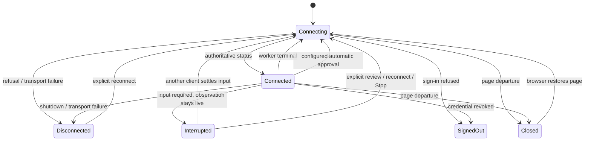

# Web module

## §web-host Hosting

An optional Agent Plugin declares one native Plurnk module. It uses the public
module lifecycle and HTTP registration seam, never a separate listener or process.
The daemon owns routing precedence, startup readiness and shutdown.

| Configuration | Behavior |
|---|---|
| PLURNK_WEB_ENABLED=1 | Claim and register `/` on the daemon's existing listener. |
| PLURNK_WEB_ENABLED=0 | Inert module: no route claims or registration. |
| Invalid value | Existing configuration diagnostic; no web module activation. |
| Package absent | No web routes. |

The package's .env.defaults owns the default. Installation is opt-in; the service
does not depend on this package. More-specific mounts retain their ownership.

## §web-route-settlement Shutdown admission and settlement

| Boundary | Contract |
|---|---|
| Stop | Refuse every new request to the module's mount with a private 503 `service-stopping` Problem, before accessing session or host resources. HEAD omits the body. Already admitted requests remain owned until their handlers settle, even if the browser disconnects. |
| Close | Stop admission, cancel diagram compilation, join all admitted handlers, then release session state and its credential observer. Close also works without a preceding stop or completed startup. |
| Failure | Unexpected handler errors still reject to the HTTP host; joining them does not turn them into success. A cleanup failure does not skip request settlement or subsequent resource cleanup. |
| Host | The daemon owns transport teardown and the overall shutdown deadline. Web adds neither a request-body deadline nor a separate shutdown timeout. No web request may reach host resources after close returns. |

## §web-configuration Configuration boundary

| Boundary | Contract |
|---|---|
| Module choices | `ai.plurnk/.env.defaults` declares enablement, browser approval mode, reasoning-preview retention, pending sign-in limits, workspace creation limits and diagram compilation limits. The daemon assembles that floor beneath operator sources; the shared `Knob` reader validates the effective values without reader-local defaults. |
| Invalid input | Refuse the affected module through the host's configuration diagnostic. Missing floor values remain an internal deployment error; neither condition silently selects a replacement value. Disabled web does not inspect unused web settings. |
| Other owners | Consume daemon authentication and credential policy through their existing configuration and public seams, never web-owned substitutes. |
| Browser | Receives only explicit public document projections, not the environment, credentials or a second set of deployment defaults. Vite compiles assets independently of operator configuration. |

## §web-assets Static resources

| Request | Response |
|---|---|
| GET `/` | Home document rendered from the packaged HTML; authenticated header controls follow {§web-page-shell}. |
| GET `/index.html` | Same root document. |
| GET `/assets/<build-generated-name>` | Compiled browser JavaScript and CSS. |
| GET `/manifest.webmanifest` | Web app manifest (`application/manifest+json`). |
| GET `/icons/plurnk.svg` | Scalable app icon. |
| GET `/icons/plurnk-maskable.svg` | Maskable app icon. |
| GET `/icons/NOTO-NOTICE.txt`, `/icons/APACHE-2.0.txt` | Artwork attribution and license. |
| GET `/vendor/OTM-LICENSE.txt`, `/vendor/PICO-LICENSE.txt`, `/vendor/DEPENDENCIES-LICENSE.txt` | Packaged substrate and bundled JavaScript dependency licenses. |
| HEAD on any served path | Same status and headers as GET, without a body. |
| Other asset path | 404 error document, never a home-page fallback or filesystem listing. |
| Asset method other than GET/HEAD | 405 with `Allow: GET, HEAD`. |

Query strings do not select assets. Paths select the build-generated asset inventory, never
filesystem paths derived from the request. Only packaged public assets are served;
configuration, source, credentials and workspace files are not public resources.
Assets are loaded during module startup: missing package bytes fail startup rather
than leaving a partially functioning page. Responses declare their media type,
byte length and `X-Content-Type-Options: nosniff`.

## §web-asset-encoding Static content encoding

| Boundary | Contract |
|---|---|
| Build | Retain each original asset. For non-HTML assets, package Brotli and gzip representations only when smaller than the original. The inventory names those representations; compression runs at build time, not startup or per request. |
| Address | All representations share the original URL and media type. Encoded files are inventory implementation details, not additional public URLs. Every declared representation must load before route registration. |
| Negotiation | Use standard `Accept-Encoding` negotiation, honoring quality weights, explicit exclusions, wildcards and identity. Among equally acceptable representations prefer the smallest. An absent or empty header selects identity; no acceptable representation yields 406. |
| Headers | Add `Accept-Encoding` to `Vary`, preserving existing fields; `Content-Encoding` only for encoded representations; `Content-Length` is the selected representation's byte length. HEAD selects the same representation and headers as GET but sends no body. No new cache lifetime is introduced. |
| Scope | Dynamic/private documents, authentication responses and other daemon mounts, including AG-UI streams, are not compressed by this handler. Their existing security, caching and streaming contracts remain unchanged. |

Reference: [HTTP content negotiation](https://www.rfc-editor.org/rfc/rfc9110.html#section-12.5.3).

## §web-index-documents Directory documents

| Request | Resolution |
|---|---|
| `/folder/` | The admitted `/folder/index.html` resource. |
| `/folder/index.html` | That same resource, with the same relative-link base. |
| `/` and `/index.html` | The root index document. |
| `/folder` | No implicit directory alias; links to directories include the final slash. |
| Missing index or child asset | 404, not an ancestor's index or the root document. |

Resolution uses the exact resource inventory, not a filesystem search or path
normalization. Query strings do not change the selected bytes. Production GET and
HEAD have the same status and headers; HEAD has no body. No redirect or history rewrite is
needed for the two index spellings. Native links, relative children, refresh and
back/forward work with JavaScript enabled or disabled. OTM does not intercept
document navigation; the server remains responsible for the document.

Production, Vite development and compiled preview share the same index-path
projection, applied before resource serving. Vite still owns HTML transformation,
compilation and HMR; no browser router is registered. Its development-only modules and
source serving are not production resources. Currently only the root document
is shipped by Vite. The daemon additionally renders the protected directories
below; worker assets remain unserved.

## §web-directory-addresses Named directory addresses

The directory codec maps names to origin-relative paths, not database IDs or
filesystem locations. It does not serve documents or authorize access.

| Directory | Generated path | Explicit document |
|---|---|---|
| Current unnamed daemon | `/~/` | `/~/index.html` |
| Workspace `~/ptl/project` | `/~/~/ptl/project/` | `/~/~/ptl/project/index.html` |
| Its worker `reviewer` | `/~/~/ptl/project@reviewer/` | `/~/~/ptl/project@reviewer/index.html` |
| Workspace `a@b`, worker `user` | `/~/a%40b@user/` | `/~/a%40b@user/index.html` |
| Workspace `index.html` | `/~/index.html/` | `/~/index.html/index.html` |

Workspace names are opaque, case-sensitive text. Encode each slash-separated
component with `encodeURIComponent`, preserving every slash, including leading,
repeated and trailing slashes. Encode the worker as one component. Raw `@` is the
worker delimiter: split it and the document suffix before decoding each name
exactly once. Literal `%2F` therefore becomes `%252F`, not a slash. Do not trim,
normalize Unicode, resolve names as paths, or interpret `~` as a home directory.

The parser accepts the folder and explicit-index spellings, percent-encoding
case variants and encoded equivalents of name characters (including `/`). `%7E`
is equivalent to the fixed `~` namespace marker. Query and fragment components
do not select a directory. Slashless directory aliases, malformed UTF-8/percent
escapes, empty names, multiple raw worker delimiters, worker child resources and
named-daemon prefixes are not directory matches. Parsing performs no lookups.

The daemon's [workspace name contract](https://github.com/plurnk/plurnk-service/blob/main/plurnk-core/SPEC.md)
admits nonempty well-formed Unicode without literal slash-delimited `.` or `..`
segments and reserves ASCII digit-only names for IDs. Admission does not rename existing
records: representable legacy names, including numeric names, retain their URLs.
The codec returns no path for an unrepresentable legacy name rather
than repairing it or substituting an ID; decoding an address to such a name is
also refused. Renaming changes its generated URL, not its identity or project
folder. No old-name redirect or filesystem exposure is implied.

This codec is verified using isolated native-document fixtures in production,
Vite development and preview. Live directory publication uses the daemon's
authentication contract.

## §web-session Browser sign-in

Web consumes the daemon's credential authority, never the operator's secret or
a second credential configuration. At setup it registers the confidential
client `plurnk-web` with callback path `/auth/callback` and scope `agui`. It asks
the published issuing face for the issuer of each request: the daemon's configured
public origin, else the address that request reached the daemon at. Its own calls to
the authority (discovery, code exchange, refresh) go to the face's answer for no
request, never to an address a browser named. No issuing face means the daemon has
explicitly disabled authentication; directory reads are then anonymous.

| Boundary | Contract |
|---|---|
| Authentication enabled, empty password | The authority shows configuration-required information and issues no browser sign-in, including on localhost. Web neither infers anonymous access nor adds a local bypass. |
| Authentication enabled, configured password | A browser signs in with `PLURNK_PASS` alone. No username field or web-owned identity configuration; a wrong password is refused by the authority at 401. |
| Authentication explicitly disabled | Anonymous directories; no Account or Sign Out controls. |
| GET `/auth/login?return=<page>` | Begin authorization code with PKCE S256 and a fresh state, bound to an HttpOnly browser cookie. Return locations are local directory addresses, `/account/` or `/account/sessions/` (also their explicit indexes); never an external URL. |
| GET `/auth/callback` | Consume the pending browser-bound state once; validate and exchange the code with client authentication. Issue a new authority `session` credential for the same subject, client, scopes and grant family, expiring with that grant's refresh credential. |
| Directory admission | Require a live authority-issued session for `plurnk-web` carrying `agui`; a bearer, refresh token, another client's cookie, or a revoked/expired session is not a web session. |
| POST `/auth/logout` | Require the issuer's exact Origin, revoke this browser's sign-in family and clear the web cookie. The authority sign-in and its module credentials end together; revisiting requires sign-in. Other browser sessions and independently authorized clients remain intact. |
| Concurrent callbacks | A new credential in the same sign-in family does not revoke that family. A genuinely different previous family is revoked. |
| Cookies | Host-only, HttpOnly, SameSite=Lax; Secure under HTTPS. Session path `/`, transaction path `/auth`. No browser storage or token in document content. |
| Request origin | A browser is answered at the address it reached the daemon by: its sign-in redirect, callback and Origin checks use the daemon's issuer for that request. No host is refused or redirected; forwarded headers are never read. |
| Failures | Invalid/replayed/mismatched callbacks fail without session issuance. Expiry/revocation requires sign-in again. Requests reveal no credential in diagnostics. |

Pending authorization state lives only in bounded, expiring module memory:
`PLURNK_WEB_LOGIN_TTL_SEC` and `PLURNK_WEB_LOGIN_PENDING` own its limits. Closing
the module clears it. Cookie and grant lifetimes come from the authority, not a
second lifetime setting. Sign-in uses the dependency-free MIT `oauth4webapi`
client and RFC 8414 discovery after listener admission; passwords are entered
only at the daemon's authorization endpoint.
Worker observation uses {§web-worker-observer}. Browser access credentials use
{§web-access-token}; they are never embedded in documents.

References: [OAuth browser applications](https://www.rfc-editor.org/rfc/rfc10017.html#section-6.2),
[OAuth security best practice](https://www.rfc-editor.org/rfc/rfc9700.html).

## §web-access-token Browser access credentials

The module is an OAuth token-mediating backend, not a second issuer. It retains
the authorization-code grant's access and refresh credentials in daemon memory,
keyed by the authority's sign-in family. The authority still owns admission,
identity, expiry, revocation and the account inventory.

| Boundary | Contract |
|---|---|
| POST `/auth/token` | Require a live web session and the issuer's exact Origin. Return only `access_token`, `token_type: Bearer`, and remaining `expires_in` seconds as no-store JSON. Other methods are 405; disabled authentication leaves the endpoint absent (404). No cross-origin access or credential-bearing redirect. |
| Access expiry | Reuse a still-valid access credential; otherwise perform the standard OAuth refresh grant with confidential-client authentication. Concurrent requests in the same family share one refresh, so rotation does not race across tabs. |
| Grant integrity | Access and refresh credentials must belong to the registered client, subject, scope and family. A refresh cannot change the family or resurrect a revoked sign-in. Failed refreshes are surfaced; no operation is replayed or authority substituted. |
| Revocation and cleanup | Authority revocation releases the retained grant. Expired grants are pruned on subsequent credential activity; module close releases them and its revocation subscription. Session expiry remains fixed by sign-in, not extended by refresh. |
| Browser custody | Access credentials are for the same-origin `/agui` endpoints and live only in JavaScript memory. Refresh credentials and client authentication never leave the server; no local/session storage, URL, document or diagnostic contains them. |
| Refusals | Missing/expired/revoked sign-in is 401; wrong/missing Origin is 403. Expected endpoint failures use RFC 9457 JSON, not an HTML sign-in redirect. |

Worker observation consumes this primitive under {§web-worker-observer}; it adds no
persistent browser state or additional session registry.

## §web-authorization-style Authorization document presentation

| Boundary | Contract |
|---|---|
| Registration | At setup the module registers the single stylesheet declared in the compiled document's head as its client's `stylesheetPath`, verifying its presence in the asset inventory. Missing or multiple document stylesheets are build-contract faults. Lazy content-renderer styles are independent assets, never authorization-page dependencies; no alias route or theme setting is added. |
| Document ownership | The authority owns sign-in, setup/error, consent and session documents, credential validation and security policy. Web supplies neither a form nor an HTML rewrite. The authority selects the stylesheet from the trusted client registration, never arbitrary request input. |
| Presentation | The same Pico Classless Green, monospace, 65ch measure, light/dark colors, native controls and article cards apply to authorization and web documents. Ordinary authorization pages work without JavaScript. |
| Production pruning | The public `authorizationDocumentSpecimens()` export from `@plurnk/plurnk-agui` supplies the authority's markup to PurgeCSS. No copied templates or private daemon-source scan. This is a development dependency, not a browser/runtime import. |

The daemon's standalone documents remain its own responsibility when no registered
module stylesheet applies. Browser coverage exercises the installed module and
authority together, including empty/wrong passwords and signed-out re-entry.

## §web-account Account and sign-ins

| Surface | Contract |
|---|---|
| GET/HEAD `/account/` or `/account/index.html` | Protected Pico article containing native navigation to Sessions. No displayed internal subject, fictional profile or inline session inventory. |
| GET/HEAD `/account/sessions/` or `/account/sessions/index.html` | Protected Pico article with Account breadcrumb and a native table of the authenticated subject's live sign-ins from `credentials.sessions(subject)`. No independent inventory. Table overflow stays inside its figure on narrow screens. |
| Each sign-in | Authority-issued creation/expiry times and client names; mark the family of the presented web session as “This session”. Do not invent device identity or last activity. Family handles are not credentials. |
| POST `/account/sessions/<family>/revoke` | Require a live web session and the issuer's exact Origin; revoke only a family in that subject's live inventory. A missing or foreign handle is 404. Revoking this session also clears the web cookie and returns home; otherwise redirect to Sessions. |
| POST `/account/sessions/revoke-others` | Same admission and Origin check; revoke all listed families except this session, then redirect to Sessions. |
| Expired/revoked credentials | Protected GET requires sign-in again; a submitted action fails at 401 rather than silently authenticating and replaying it. |
| Explicit anonymous posture | Account documents and actions are absent (404); no fictional account. |

Forms work with JavaScript enabled or disabled. Read and mutation responses use
the private headers in {§web-directory-documents}; GET never revokes anything.
Revocation does not mutate workers, workspace ownership or independently authorized
client credentials. The daemon owns credential lifetime, grouping and revocation.

## §web-directory-documents Read-only directory documents

| Document | Content / lookup |
|---|---|
| `/` | Public foundation document and a real link to `/~/`. |
| `/~/` | `listWorkspaces()`: native list articles with exact-name links under {§web-page-shell}, and the folderless creation form under {§web-workspace-creation}. CSS prefixes names with ☁️ when `project_root` is null, otherwise 🗂️; article names identify folderless/project workspaces independently of glyphs. Never infer folder presence from the name. |
| Workspace directory | Exact-name lookup in `listWorkspaces()`, then folder presentation under {§web-workspace-folder} and one `listWorkers(id)` census rendered under {§web-worker-directory}. |
| Worker directory | Exact-name model-worker lookup; identity, breadcrumbs and actual parent under {§web-worker-directory}, plus passive status under {§web-worker-observer} and conversation under {§web-worker-conversation}. |
| Missing workspace/worker | 404; never create, attach, claim ownership, start a loop or infer a project folder. |
| Unrepresentable legacy name | Escaped text without a link; no renamed display, ID substitution or broken generated URL. |

Every directory (including a missing one) is authenticated before data lookup.
GET and HEAD have matching status/headers; HEAD has no body. Documents and auth
responses are `Cache-Control: no-store`, suppress referrers, prevent framing and
use same-origin scripts, styles and forms. Names are escaped as text/attribute
values; never executable HTML or filesystem paths. Ordinary navigation and
logout use native links/forms with JavaScript enabled or disabled. Rendering
reuses the compiled root document's head, styles, icons and OTM boot; no browser
router, client-side list fetch, duplicate English dictionary or extra UI library.

Vite development/preview continue to serve frontend documents only: dynamic
directory/auth routes require a daemon. The installation gate accepts explicitly
supplied published or candidate platform archives to verify the public contract.

## §web-workspace-folder Workspace and folder labels

Compare the workspace name with the daemon's `project_label` by exact equality.
Render that label as escaped text, never a filesystem link. Do not derive a label
from `project_root`, the browser's location, the client's home or the workspace name.
The daemon owns home abbreviation; names remain opaque and unchanged.

| Workspace page | Breadcrumb | Separate folder line before the worker list |
|---|---|---|
| Folderless (`project_label: null`) | ☁️ name | None. |
| Name equals folder label | 🗂️ name | None; the breadcrumb already identifies the folder. |
| Name differs from folder label | ☁️ name | 🗂️ followed by the supplied label. |

The workspace index continues to mark folder presence under
{§web-directory-documents}, irrespective of name equality. Accessible icon labels
distinguish the workspace identity from its project folder; a cloud on a named
workspace with a separate folder must not claim it is folderless.
## §web-workspace-creation Folderless workspace creation

The daemon workspaces directory (`/~/`) header carries a native creation trigger button (`➕`);
individual workspace, worker, account and error documents never do. Activating the trigger
opens a native `<dialog>` modal (`#dialog-workspace-create`). When JavaScript is disabled, the form
renders in normal flow and submits cleanly without client scripting.

| Boundary | Contract |
|---|---|
| Form | A native modal (`#dialog-workspace-create`) containing one `method="post" action="/workspaces/new"` form (`#workspace-create`) with Cancel and Confirm buttons, a text input named `name` pre-populated with an automatic candidate name (five alphanumeric characters with at least one letter), and exactly one hidden token field containing a fresh UUID. Users may submit to accept the suggested name, edit it, or cancel/escape to dismiss without mutating state. Resting `<main>` on `/~/` contains only directory content. |
| Folder independence | Creation calls the public `createWorkspace` with `projectRoot: null`, never inheriting another workspace's folder, the daemon's working directory or an operator home. It starts no loop, worker or inference, copies no history, creates no project directory, and leaves other workspaces untouched. |
| Admission and origin | With authentication enabled, an unadmitted POST answers 401 and a cross-origin form 403 against the daemon's issuer. `PLURNK_AUTH=0` is a first-class anonymous posture, not a read-only mandate: creation requires a matching same-origin `Origin` header naming the request's own host, and any `sec-fetch-site` other than same-origin is refused with 403. |
| Method and encoding | Only POST is allowed; GET and HEAD answer 405 with `allow: POST`. The body is UTF-8 `application/x-www-form-urlencoded` (415 otherwise), bounded (413), with exactly one `token` field (400 otherwise). |
| Convergence | The hidden token is the form's idempotency key at the module's HTTP boundary, because the daemon's creation contract has none. Token tracking begins on `POST /workspaces/new`. The first POST creates one workspace and answers 303 to its canonical address through the shared directory codec. Racing or retried POSTs of the same valid token converge to that same workspace, never a second creation. A settled token stays addressable for the configured TTL, so a retry after a lost response converges. An invalid UUID format answers 400. |
| Failure | A daemon rejection answers 502 with its cause preserved, and the settled failure is not blindly re-executed within its TTL. An envelope that names a project folder for a folderless request, or a workspace name without a directory address, is a visible internal violation, never a silently adapted creation. |
| Bound | In-flight and settled tokens are pruned on expiry and bounded across actual POST submissions: exceeding `PLURNK_WEB_CREATE_TOKENS` evicts the oldest settled completed outcome. In-flight creations remain protected during convergence. |

## §web-workspace-rename Workspace rename

Workspace page (`/~/<workspace>/`) headers carry a native rename trigger button (`✏️`);
daemon, worker, account and error documents never do. Activating the trigger opens a native
`<dialog>` modal (`#dialog-workspace-rename`). When JavaScript is disabled, the form renders in normal
flow and submits cleanly.

| Boundary | Contract |
|---|---|
| Form | A native modal (`#dialog-workspace-rename`) containing one `method="post" action="/workspaces/rename"` form with the current workspace name in a hidden `workspace` field, a required text input named `name` pre-populated with the current name, and Cancel and Confirm buttons. Dismissing via Cancel or Escape performs no mutation. Resting `<main>` contains only directory content. |
| Delivery | Uses the public `renameWorkspace(workspaceId, name)` contract on `ApplicationPort`. Missing workspace answers 404; empty name answers 400. Rejection answers 502 with cause preserved. Success 303-redirects to the canonical new workspace directory address through the shared directory codec. |
| Origin and method | Only POST is permitted; GET and HEAD answer 405 with `Allow: POST`. Same-origin enforcement requires matching `Origin` and same-origin `sec-fetch-site` in both auth and anonymous postures. |

## §web-worker-creation Worker creation

Workspace page (`/~/<workspace>/`) headers carry a native worker creation trigger button (`➕`);
daemon, worker, account and error documents never do. Activating the trigger opens a native
`<dialog>` modal (`#dialog-worker-create`). When JavaScript is disabled, the form renders in normal
flow and submits cleanly.

| Boundary | Contract |
|---|---|
| Form | A native modal (`#dialog-worker-create`) containing one `method="post" action="/workers/new"` form with the current workspace name in a hidden `workspace` field, a hidden UUID `token` field, a text input named `name` pre-populated with an automatic candidate name (eight random lowercase hexadecimal characters), and Cancel and Confirm buttons. Dismissing via Cancel or Escape performs no mutation. Resting `<main>` contains only directory content. |
| Delivery | Uses the public `createWorker({ workspaceId, name? })` contract on `ApplicationPort`, creating an independent model worker without inheriting parentage, loops, transcripts, or forking active state. When a name is provided, creation requests it; when omitted or blank, the daemon generates one. |
| Convergence | The form token acts as idempotency key: racing double-clicks and retries converge to the single created worker. Expiry and bounds share the creation limits. |
| Success and failure | Missing workspace answers 404. Success 303-redirects to the new worker's canonical directory address (`directoryPath({ kind: "worker", workspace, worker })`). Rejection answers 502. |
| Origin and method | Only POST is permitted; GET and HEAD answer 405 with `Allow: POST`. Strict same-origin enforcement applies in both auth and anonymous postures. |

## §web-worker-directory Model-worker navigation

| Boundary | Representation |
|---|---|
| Children | Immediate model children nest beneath their actual model parent. Preserve daemon order among siblings. |
| Card identity | Two lines: a named ant link to the worker, its lifecycle glyph, optional actual parent followed by `>`, and the worker name; then a folder/cloud marker and a real link to its workspace. Model parents are links; bookkeeping parents are escaped text, never fabricated worker destinations. Folder presence comes from `project_root`, not the workspace name. Kind and permission owner do not become visible metadata rows. |
| Lifecycle | Project the supplied lifecycle with the same glyph vocabulary as the worker statusline; the icon has a literal accessible name/title. These are directory facts at page load, not locally inferred or continuously updated status. No reply content, completion timestamp or recency ordering is inferred from this census. |
| Background | Model workers with an immediate non-model parent begin branches in one collapsed “Background work” section. Omit it when empty. No A2A-specific classification or reparenting. |
| Disclosure | Each card is `li > article`. When it has children, one initially closed `details` contains its two-line identity as a phrasing-only `summary`, followed by the actual nested `ul/li` child cards. Leaves use a `header` with the same identity and no empty disclosure. Activating a summary opens the card; activating its ant, parent or workspace link navigates without toggling it. Native keyboard and pointer behavior work without JavaScript; no separate child-count teaser. |
| Parent on worker page | Show the actual parent's name: a link for a model parent, escaped text for a bookkeeping parent. Roots omit the parent line. URL breadcrumbs remain workspace/worker navigation, not invented lineage paths. |
| Placement | The complete workspace tree belongs only to the workspace page. Worker pages retain breadcrumb and parent navigation, and use {§web-worker-descendants} for live descendant navigation; no duplicated page-load tree. |
| Integrity | Duplicate identities, absent referenced parents and cyclic model parentage are internal contract failures; never silently omit or invent workers. |

Rendering and expansion perform no attachment, inference, ownership change or
daemon mutation. There is no browser topology cache, saved expansion state,
lazy branch request, custom tree role or JavaScript disclosure handler. Opening a
worker page may observe it under {§web-worker-observer}, never control it.

## §web-worker-observer Read-only worker status

The server renders a semantic status footer only for an existing model worker,
with the daemon's qualified thread identity (`<workspace ID>#<worker name>`) and
whether access requires a browser session. URLs and breadcrumbs retain readable names;
renaming a workspace does not redirect an already-open observation to another worker.
No credential appears in the document. JavaScript enhances that footer; other
pages neither load HttpAgent nor request access credentials or AG-UI streams.
Without JavaScript the identity and navigation remain usable, with an explicit
notice that live status requires JavaScript.

| Boundary | Contract |
|---|---|
| Transport | A fresh official HttpAgent via its public connection hook, using `/agui/connect` and the qualified `threadId` supplied by the document. No forwarded workspace, action, resume, control claim or capability replacement. A pending review keeps its current SDK instance and names `pendingInterrupts` in `forwardedProps.plurnk.interrupts`; the held connection observes until a gate settles. SDK owns event parsing, replay and state patches; a fresh attachment rediscovers current conversation and interrupt continuations. |
| Credentials | Before each connection, use {§web-access-token}; explicitly anonymous documents send no Authorization header and never call `/auth/token`. An admitted stream outlives access expiry. Credentials live only in the active request/SDK instance and are released on departure. |
| Continuity | Standard successful/cancelled `RUN_FINISHED`, or `RUN_ERROR` carrying a worker terminal in `metadata.plurnk.terminal`, ends the delivery; reconnect passively to watch subsequent work. A held observation may finish when its gate settles, before the worker concludes: only daemon status/terminal evidence establishes the worker outcome. A protocol/credential failure stops observation. An interrupt applies {§web-worker-input}: configured approval or explicit input required. Never retry work or infer completion from transport closure. |
| Disconnection | Transport/protocol failure, admission refusal, or daemon shutdown stops reconnection. Show a Pico error card with the failure's diagnostic, retain clearly stale last-observed values, and offer a native Reconnect form. Credential-response failures describe the status or invalid format, never response bytes or headers. Its enhanced submission reattaches without navigation, preserving the draft; it never resubmits input. A revoked/expired browser session offers native sign-in instead. No background polling or retry/backoff system. |
| Page lifetime | `pagehide` closes the observation and stops local timers without cancelling the worker. A restored page opens a fresh observation. Hidden tabs do not claim or cancel work. |
| Projection | Public state supplies identity under {§web-worker-identity}, status under {§web-worker-status}, and the complete descendant census under {§web-worker-descendants}. The browser keeps no accounting ledger, inferred topology or transcript cache. |
| Elapsed | Measure the latest loop from daemon `claimedAt` to `terminatedAt`, or the current clock while connected. Update seconds locally; freeze on disconnect. No claim time means unknown. Local clock arithmetic never changes daemon lifecycle or accounting. |
| Presentation | The compact footer under {§web-worker-status} uses native HTML and OTM text/state projection, ordinary light/dark Pico styling, no application classes or imperative styling. Connection changes and errors are announced separately; ticking gauges are not live announcements. A healthy connection needs no persistent “Connected” label. |

Opening the page submits no message and cancels no work. Existing owner proposals
may receive the configured response under {§web-worker-approval}. Message
submission and explicit cancellation belong to {§web-worker-input}.

## §web-worker-identity Current names, fixed observation

| Boundary | Contract |
|---|---|
| Binding | The document's qualified thread ID is immutable for its lifetime. Workspace state must identify that same workspace; a different ID is a contract failure, not permission to retarget observation. |
| Names and navigation | Each supplied workspace state refreshes the workspace breadcrumb, document title, project-folder label and workspace-relative navigation destinations using the shared directory codec. Worker and parent names remain document facts. An idle connection does not discover a rename until the daemon supplies updated state or a new attachment snapshot. No polling or browser name registry. |
| Folder | Apply {§web-workspace-folder} on worker pages too: compare the supplied name and folder label exactly, never abbreviate or resolve filesystem paths in the browser. |
| Location | Keep the current URL and history unchanged. Current breadcrumb and parent links use the latest supplied workspace name; sign-in and reconnect destinations follow it too. An old URL still returns 404 after a rename, rather than becoming an identity alias. |

## §web-worker-status Live worker and workspace facts

| Surface | Projection |
|---|---|
| Document | A body-level footer contains status above the composer. Center two wrapping groups: automatic approval/model/effort, then the remaining statistics with cost last. Each group fits the available width; a long model route can occupy its own row above statistics. No repeated workspace/worker identity or metadata inventory. Each field has an accessible name independent of CSS-generated glyphs and separators. The SDK retains full state; the DOM is not a second dataset. |
| Visibility | Hide the status row without reserving space unless the worker is queued, running or parked, focus is within the footer, or its model/effort selector is open. Keep it present through pointer activation of its controls. An unknown lifecycle still supplies no status row. Composer and connection feedback remain independent. Native focus/disclosure state and existing lifecycle attributes own visibility through CSS, without another JavaScript state or timer. |
| Worker | `plurnk.status` supplies lifecycle and resolved model/effort. Show the alias, otherwise provider/model, with supplied effort and no decorative model glyph; retain the full route and effort source in its description. A null model says “No model”; absent effort uses a neutral placeholder so its selector remains reachable. Completed lifecycle has no visible indicator or reserved space; other supplied states retain theirs. Page-local automatic approval uses a native toggle button: pressed with 🔥 when enabled, unpressed with 🐹 for manual review. Its stable accessible name is “Automatic approval”; CSS supplies the glyph. It shares `/yolo` behavior under {§web-worker-commands}, without submitting the draft or adding a command-history entry. Descendant counts and pending gates follow {§web-worker-descendants}; neither changes the bound worker's lifecycle. No provider fallback. |
| Clocks | Elapsed follows {§web-worker-observer}, not the browser session, and is omitted without a claim timestamp. WAIT shows whole seconds remaining, rounded up and clamped to zero, with the supplied deadline on its native time element. A null deadline clears it. Expiry neither changes lifecycle nor claims completion or resumption. Both clocks repaint only while connected or awaiting input, and freeze when delivery is unavailable. |
| Context | Root `budget` supplies context occupancy/capacity. Show only percentage/capacity (for example, `11%/650k`) when both values are known and capacity is positive; descriptions retain exact supplied values. Curation stays in SDK state, without a document projection. Unknown input clears the field, never retains an older snapshot or substitutes accounting totals or model configuration. |
| Accounting | Show daemon cumulative worker-and-descendant input/output tokens and USD cost, never a page-local ledger. Cost is the last list item in document order. Tokens use compact notation; cost uses four fractional digits, with a nonzero amount below display precision shown as less than that precision, never zero. Missing totals show `?`; a supplied known subtotal may precede `+ ?` but never becomes a total. Accessible descriptions retain exact reported values and distinguish partial from complete evidence. No summing, estimated prices or inferred token partitions; formatting never mutates SDK state. |
| Workspace activity | Show current preparation phase and family/alias, and indexing phase with the supplied percentage when present. Retain the indexing message as a description, without reconstructing progress or printing the full activity record. Empty preparation and null activity clear their fields. These are workspace facts, not worker lifecycle or conversation messages; a worker terminal alone does not clear them. |
| Inbox | Show a count only when accepted-unobserved messages exist. It describes observation, not execution or a promise that a terminated loop will consume them. Do not render message IDs, paths or receiving-loop records as a status inventory. |
| Continuity and admission | Project the SDK's complete state after snapshots and deltas. Native disclosures remain open across updates; names, messages and other supplied strings are literal text. Disconnected values remain visibly stale under {§web-worker-observer}. Observation, timer ticks and disclosure do not submit actions or initiate extra network requests. |

## §web-worker-descendants Live descendant navigation

| Boundary | Contract |
|---|---|
| Authority | `status.descendants` is the daemon's complete census beneath the bound worker. Render every supplied worker once, nested by `parentWorkerId`, preserving sibling order; do not infer workers or activity from transcripts, query the directory, or merge successive censuses. This live subtree is distinct from the workspace navigation snapshot under {§web-worker-directory}. |
| Counts | Alive direct children are roots of that census whose lifecycle is queued, running or parked. “Descendants awaiting input” counts workers at any depth with `gates > 0`, not the number of gates. Show each worker's exact gate count beside its kind and lifecycle; a pending gate does not change its lifecycle locally. |
| Document | A native disclosure in the footer shows the descendant count, describing active direct children in its accessible name. It is initially closed and absent from presentation when the census is empty, with no placeholder. Opening it reveals nested `ul/li` lists, real named worker links and separate child disclosures; leaves have no child disclosure. Names and facts are literal text. Destinations use the current supplied workspace name and shared directory codec. |
| Continuity | A replacement census updates membership, facts and counts. Preserve open native child disclosures by worker identity for surviving branches; new branches start collapsed. Unchanged projections retain their nodes. Workspace renames update links without retargeting the bound worker or changing browser history. Disconnection leaves visibly stale evidence, not an invented empty tree. |
| Integrity | Duplicate identities, cycles, or roots pointing to different absent parents are contract failures. A census may reference only its one excluded bound worker as the roots' parent. No silent reparenting, dropped workers, hierarchy inferred from names or client-owned lifecycle. |

## §web-worker-diagnostics Observed notices and Problems

| Boundary | Contract |
|---|---|
| Intake | The current HttpAgent's `onCustomEvent` receives `plurnk.notice` and `plurnk.problem`. Validate each through its public contracts validator. Unknown custom events are not interpreted as diagnostics. These nonterminal events never change lifecycle, end observation, resume an interrupt or enter the SDK conversation. |
| Document | A separate native list uses {§web-card-disclosure}. Its header contains the literal Notice message (otherwise source/kind) or Problem title beside its severity glyph. Distinct Problem detail/recovery is an initially collapsed literal body, without duplicating the title. Accessible naming conveys severity, source/kind or title and supplied subagent attribution. Entry attributes carry relevant semantic facts; no glyph markup or full-payload disclosure. Hide the section when it has no entries. |
| Retention | The page retains distinct observed diagnostics across delivery changes and reconnects. An exact repeat of the event name, payload serialization and subagent attribution reuses its existing entry. Deduplication evidence stays in JavaScript, not DOM storage. This is neither an occurrence count nor a durable diagnostic history: reload starts from what the daemon supplies again. No browser storage, transcript reconstruction or inferred error resolution. |
| Authority | Notice severity is producer-supplied; an error-level Notice or nonterminal Problem is not a failed worker. Connection errors and operation results keep their existing owners. The diagnostic list does not claim to contain events from before attachment or from unobserved children. |

## §web-worker-activity Observed non-conversation activity

| Boundary | Contract |
|---|---|
| Intake | The current HttpAgent supplies `CUSTOM plurnk.ambient` client-facing log rows and `CUSTOM plurnk.outside` text emitted outside operations. They remain separate from SDK messages, reasoning previews, diagnostics, approvals and lifecycle. Unknown event families are ignored. Invalid identity or displayed fields fail at intake, not as empty activity. |
| Document | A native “Observed activity” disclosure contains an unnumbered `ul` list of articles using {§web-operation-summary} and {§web-card-disclosure}, with the authored body as literal text and, when supplied, a collapsed reasoning disclosure. These observations start collapsed, including outside text; they are evidence, not delivered replies. Its accessible name identifies operation, worker, coordinate and result state. Relevant identity, origin, coordinate, state, status and attribution live on the entry as scalar attributes. Outside text is literal content with accessible “Outside operations” attribution and coordinate, never an assistant answer or a copy in data attributes. No inferred names, worker tree, heading parsing or executable markup. |
| Duplication | Ambient rows use their worker and row IDs plus supplied subagent attribution; outside text uses its coordinate plus attribution. Repeated delivery updates that entry in first-observation order. Unchanged evidence preserves its nodes and inspected bodies. Deduplication and reference-render bookkeeping stay in JavaScript, not DOM storage. Changed references replace only their inspection outlets. The `_plurnk` READ row with `attrs.kind=emission` is omitted because its announced operations already have their own conversation representation; rejected emissions and other ambient rows are not suppressed. |
| Content | Operation summaries do not fetch receipt bodies. Referenced reasoning uses {§web-result-bodies} and stays unread until its disclosure is opened and visible. Fetches never add text to future conversation uploads. |
| Retention | Observations belong to this page, not a durable history. Delivery changes and reconnects retain them; reload starts with only what the daemon supplies again. Do not reconstruct past ambient/outside events from messages, poll for them, persist them in browser storage or imply unseen activity was absent. Disconnection retains visibly stale evidence under {§web-worker-observer}; neither events nor browser departure cancel or complete work. |

## §web-worker-streams Observed executor outcomes

| Boundary | Contract |
|---|---|
| Boundary | The worker page has no open-stream inventory or progress ledger. `status.streams` stays in SDK state; channel-progress events create no document projection. Worker lifecycle, WAIT and conversation receipts retain their own presentation. |
| Document | A native “Observed stream outcomes” disclosure lists conclusions received on this page. It is absent from presentation when empty. All supplied values are literal text; unchanged outcomes retain their disclosures and inspected output. |
| Outcomes | A stream conclusion is separately retained as a page-local observed outcome: resource, producer, supplied summary and Problem details. Result status and supplied exit code classify the entry; the full result is not dumped into markup. Deduplication remains in JavaScript. Identical repeated conclusions reuse the disclosure. Channel closure, command exit and worker outcome are distinct. Reconnection retains observed outcomes; reload does not reconstruct them from conversation history. |
| Inspection | A native Read output control makes one explicit public `entry.read` management Run for that target and the page's immutable thread. Acquire fresh same-origin credentials; declare no tools or control claim and upload no conversation. Validate the public `EntryReadResult`. Render every returned channel's exact text, state, MIME type and code-point length as a labelled output snapshot, never Markdown or executable content. The control remains available for an explicit refresh. |
| Failure and lifetime | Pending reads disable their own control. Failed reads preserve prior output, show the diagnostic and allow explicit retry; a disappeared row cannot receive a late response. Page departure aborts browser-owned reads, never execution. Disconnection retains visibly stale evidence under {§web-worker-observer}. No automatic output fetching, polling, stream cancellation or browser persistence. |
| Separation | Inspected output and outcomes stay outside SDK messages and future conversation uploads. Ordinary tool results remain authoritative conversation evidence. A stream failure neither completes the worker nor ends its observation. |

## §web-worker-input Message composer and explicit Stop

| Boundary | Contract |
|---|---|
| Document | A document-owned OTM template places ⏹️ Stop, a native textarea named Message, and ▶️ Send in one row below status. The textarea starts at one line, grows with content to a bounded viewport-relative height, then scrolls internally; both buttons stretch to its height. Send uses Pico's primary palette and Stop its secondary tokens. The buttons submit independent native forms: Stop neither validates nor resets the message field. Icon-only buttons retain accessible names and native explanatory titles. JavaScript mounts them only on worker pages; questions and command results stay in main, not the pinned composer. |
| Keyboard | Enter remains a newline. Ctrl+Enter in the message field requests native Send-form submission, preserving validation, slash-command routing and delivery availability. Composing text and repeated keydown events do not trigger the shortcut. The Send button exposes the shortcut in its title and accessible keyboard metadata. |
| Focus | The textarea retains a visible inward focus ring, keeping its visual boundary aligned with adjacent buttons as its content grows. Focus does not change the controls' geometry. |
| Send | Except for slash commands under {§web-worker-commands}, submit exact nonblank text as one standard user message to `/agui`, on the document's qualified thread. New text gets a new ID; a deliberate retry of the same unconfirmed draft retains its ID for daemon idempotency. Message identity generation works on ordinary HTTP as well as secure contexts; it does not change transport security or authentication policy. A message or response Run declares an attended client and no unimplemented tools; passive connection alone never attaches control. Server permissions remain unchanged. |
| Handoff | One current HttpAgent owns the displayed messages. Close and await the preceding delivery before using its received history for a message or response Run. Held observation preserves the SDK's current interrupt set and the unsent review form; after settlement or explicit reconnection, passive reattachment starts fresh under {§web-worker-observer}. Follow-ups during live work use the same ordinary message admission; no parallel transcript, injection endpoint, automatic retry or offline queue. |
| Admission | The daemon's `status.inbox`, user-message snapshot or user-message arrival confirms acceptance by message ID; local SDK insertion never does. Acceptance precedes model observation: queued follow-ups remain discoverable during inference, after reconnect and after cancellation before observation. Their eventual arrival retains the same ID and does not repeat text. |
| Draft | Prevent another submission until acceptance or explicit rediscovery after a failed delivery. Clear the submitted text only if the textarea still contains it, preserving newer typing. A refusal or uncertain connection failure retains the draft, explains uncertainty and requires explicit reconnection before another submission. Reattachment may confirm acceptance; absence is not proof of refusal, so a deliberate unchanged retry retains its idempotency key. No automatic resend, browser persistence or guarantee across full reloads is implied. |
| Stop | Explicit submission invokes public `loop.cancel` for the same thread through an independent management Run, with no conversation messages. Its acknowledgement requests cancellation; only worker status/terminal events establish the outcome. Stop preserves unsent text and targets no unrelated worker. Show it only for known queued, running or parked work; unavailable delivery or an in-flight cancellation disables it without hiding known live work. A pending follow-up does not prevent stopping already-running work. |
| Interrupt | Retain the SDK's pending interrupts and call evidence. Proposals use the configured client choice under {§web-worker-approval}; questions and MCP input use {§web-worker-questions}. Input-required is not disconnection: keep observing authoritative work and pending-input changes through the public adapter contract. Unsupported interactions remain pending with an explicit notice. Send is unavailable until settlement; explicit Stop remains available for live work on this worker. |
| Failure and departure | Request failure is visible, never a successful send or cancellation. Refresh, navigation, page close and delivery handoff only release browser resources: they cannot cancel admitted work. No message or cancellation is automatically resubmitted after reconnect. |

## §web-worker-commands Worker-page slash commands

The first non-whitespace `/` selects a client command, never a model prompt.
The browser translates input to existing daemon actions; it owns no model,
capability, persistence or execution policy. Commands require no inference.

| Input | Effect |
|---|---|
| `/help [command]` | Show this browser's supported commands or the named command's usage. Bare `/` shows the same index. |
| `/models [search]` | Inspect declared aliases and one bounded, optionally searched model-catalog page through `providers.list` and `models.list`. Preserve the supplied page counts; further search narrows the catalog. No endpoint probes. |
| `/model [selector] [effort]` | `worker.model.get` inspects the bound worker's durable route; `worker.model.set` selects it, optionally with effort in the same action. Display the confirmed route, not the submitted selector. |
| `/effort [policy]` | `worker.effort.get` or `worker.effort.set`, using the daemon's `effort` field. Present the confirmed effort, provenance and supported efforts; no client-owned list of admitted policies. |
| `/capabilities [json]` | Inspect or replace the workspace policy through `workspace.capabilities.get` or `workspace.capabilities.set`. Present service, workspace and effective layers separately, preserving exact policy values. |
| `/yolo` | Toggle the current page's client approval preference under {§web-worker-approval}. No daemon action, credential request or model message. |
| `/stop` | The same explicit cancellation path as the Stop form under {§web-worker-input}; an idle worker is not an error. |

| Boundary | Contract |
|---|---|
| Scope | Only the listed commands. Unknown names and invalid argument shapes report a local diagnostic without inference or a substitute command. No terminal process, filesystem bridge, host-file imports/exports, external editor, command navigation or duplicate terminal framework. Workspace/subsystem management belongs to its own page surface. |
| Delivery | Each daemon action uses an independent official HttpAgent management Run on the document's immutable thread, fresh credentials, empty messages and no tools or control claim. Preserve exact Problem details. Action results never replace the observer's SDK state or messages. |
| Presentation | Document-owned native templates render help, model tables, requested policy layers and confirmed outcomes. Failures show their diagnostic and recovery, not a duplicate serialized Problem. Do not add raw result inspectors. A separate page-local command-results list records each submitted command and its outcome; it is not conversation, durable history or browser storage. |
| Admission | Command intake is independent of model-message admission: pending reviews do not block commands. One ordinary command is pending at a time; the separate Stop form remains reachable. A successful command clears only its unchanged draft; failure retains it, and newer typing is never cleared. No automatic retries. |
| Client approval | A YOLO change applies to outstanding proposals and future ones. Enabling it may submit an all-proposal pending set through the existing complete resume path. Questions and MCP input still require explicit answers; toggling preserves their unsent answers. Disabling cannot revoke an already-submitted decision. Reload restores the configured default. |
| Lifetime | Leaving the page aborts browser delivery, not an admitted mutation or agent work. An interrupted response is shown as unconfirmed, not left running if the browser restores the page. Commands and their results are never uploaded on later model messages. Command errors cannot end observation or fabricate successful model/effort changes. |

## §web-worker-settings Native model and effort selection

| Boundary | Contract |
|---|---|
| Disclosure | Model and effort buttons reveal their respective inline articles after the conversation in main, never overlays. Native expanded/controls attributes identify the relationship. Opening focuses the form. Cancel and a confirmed selection return focus to the button before closing the article, preserving the status row under {§web-worker-status}; a failed selection remains open. No separate Close control, visible heading, catalog counts or ordinary success narration. A missing effort still permits inspecting the daemon's supported choices. |
| Models | One native search input with a “Search Models” placeholder and accessible name, a `datalist` of suggestions, then Cancel / Select Model. Input queries the daemon's entire catalog using the same validated actions as `/models`; suggestions are a bounded result page, not a selectable-route allowlist. Search beyond the initial page by typing, or enter any exact alias/provider-model for daemon validation. Preserve supplied readiness in suggestion labels. Superseded reads cannot replace current suggestions or report stale failures. Search never selects a model; only explicit submission through `worker.model.set` does. No provider probes, model-name guesses, inferred effort policies, client catalog or custom combobox. |
| Effort | One native select with disabled “Reasoning Effort” placeholder, then Cancel / Select Effort. Offer only the daemon's `supportedEfforts` from `worker.effort.get`; submit through `worker.effort.set`. An empty set has no selectable policy and reports that fact. |
| Authority | Forms and slash commands share result validation and public management actions. Only confirmed mutations report success; refusal remains visible with its recovery and preserves the selection and message draft. Observer state remains authoritative for status. No conversation entries, inference, duplicate client policy or automatic retry. Leaving the page aborts delivery, not admitted work. |

## §web-worker-approval Configured operation review

| Boundary | Contract |
|---|---|
| Status hover | The native toggle title describes the current mode as “Auto Approval (/yolo)” or “Manual Approval (/yolo)”. Its accessible toggle name stays stable while pressed state expresses enabledness. |
| Authority | The current HttpAgent's `pendingInterrupts` supplies the complete presented set. `metadata.plurnk.proposal` supplies daemon-owned review facts. No client approval registry, permission rules, inferred ownership, or reconstruction from conversation calls. A delegated proposal need not have a `toolCallId` on its owner's thread. |
| Configuration | `PLURNK_WEB_YOLO=1` automatically accepts approval proposals with decision `accept` and outcome `client_yolo`; `0` requires manual review. Read at module startup through {§web-configuration} and project the resolved switch as the native status toggle's pressed state. That toggle and `/yolo` change the same preference for the current page under {§web-worker-commands}; browser assets contain no policy default. This client choice cannot override daemon rejection and does not veto decisions by other authorized clients. |
| Document | Manual review uses one document-owned native form, a fieldset per operation, and required Accept/Reject radio choices with neither selected. Show the requesting worker, operation, target and exact body, without a duplicate full-proposal dump. Review facts are literal text, never Markdown, executable controls or application bindings. |
| Decision | Submit the complete presented set in one standard HttpAgent `resume` to `/agui`, retaining its opaque interrupt IDs and current thread. Each proposal entry has resolved status and the configured or explicit decision. An all-proposal YOLO set submits automatically. Questions and MCP input always require explicit answers under {§web-worker-questions}; mixed sets combine those answers with the configured proposal decisions, never a partial submission. No new message, approval tool, synthetic tool result or body editing. The daemon owns validation, settlement and the operation's actual result. |
| Handoff | Disable review during submission, then follow the ordinary SDK conversation and outcomes. A subsequent gate applies the configured mode anew; manual choices start unselected. Otherwise return to passive observation. Keep unsent message text. Stop remains explicit cancellation of the page's worker, not rejection of a proposal or cancellation of another requesting worker. |
| Refresh and concurrency | Several authorized clients are ordinary views of one pending decision. The daemon settles once; all views withdraw obsolete controls and follow the resulting work without another answer or manual reconnection. Reconnection rediscovers current gates and fresh continuations. Never replay unsubmitted choices after refresh or retry a decision automatically. A stale, refused or uncertain submission is not acceptance; retain its diagnostic without obscuring independently confirmed progress. Actual delivery/credential failures follow {§web-worker-observer}. |
| Settled response | A resume refused with 409 `interrupt-not-pending`, `proposal-not-pending` or `interaction-not-pending` shows the refusal, then reconnects for current state without resending the answer. Other failures remain failures; a refusal does not acknowledge this client's decision. |
| Departure | Refresh, navigation, page close and lost delivery cannot reject a proposal, cancel work or undo an accepted decision. They release browser delivery only. |
| Unsupported sets | Every presented interrupt must be a review proposal or a question supported by {§web-worker-questions}. Otherwise do not submit a partial set or guess a missing response contract. Explain that the interaction is unsupported and leave it pending. |

## §web-worker-questions Schema-shaped answers

| Boundary | Contract |
|---|---|
| Authority | Questions and MCP input use the same standard interrupt/resume path as {§web-worker-approval}. The SDK supplies the pending set, the associated tool call and `responseSchema`; the browser invents no question endpoint, MCP continuation or interaction identity. |
| Attribution | When supplied, `metadata.plurnk.interaction.workerId` identifies the requesting worker in the question heading, including delegated questions and rediscovery. Never infer that identity from a tool-call or interrupt ID. Generic questions remain answerable without this metadata. |
| Document | Show the request message, tool name and exact call arguments as literal text. Keep the full response schema inspectable. Straightforward object properties with independent string, number, integer, boolean or enumerated values use native controls in document-owned templates. Other schemas remain whole in an explicitly labelled JSON editor; references, nesting and conditional rules are never flattened or partly discarded. |
| Values | Preserve strings verbatim and retain numeric, boolean and enum types. Optional fields have an explicit inclusion choice, so omission differs from an empty string, false or zero. Schema defaults may prefill an answer but cannot submit it. A required string may be empty unless the schema prohibits it. |
| Validation | Native controls enforce their own input constraints. The existing public contracts validator checks the complete proposed answer against the exact schema before sending; validation failure preserves editable input and shows the error. Invalid or unresolvable schemas remain visible and cancellable. Daemon validation and settlement remain authoritative. No schema reference initiates a browser network request. |
| Resolution | Explicit submission answers or cancels every presented request in one SDK resume, retaining opaque interrupt IDs. Cancellation of a question is not Stop and does not cancel unrelated work. Mixed proposal/question sets use the same complete-set rule. Advertise `question` and `mcp_input_required` only on controlling Runs with these handlers. |
| Lifetime | Reuse {§web-worker-approval}'s rediscovery, concurrent-client, uncertainty and departure rules. A failed or uncertain submission is not acceptance and is never retried automatically. Refresh does not preserve unsubmitted answers; correcting local validation does. |
| Security | No request, schema title, field name or answer becomes HTML, an application binding, a navigation instruction or executable code. Keep user data in memory/controls only, not browser storage. External URLs in requests are text, never automatically opened. |

## §web-worker-conversation Conversation projection

| Boundary | Contract |
|---|---|
| Authority | The worker HttpAgent's ordered `messages` collection is the sole live transcript. Read-only daemon history pages join its display under {§web-worker-history}, never its collection or Run input. No CUSTOM-row reconstruction, browser persistence or second event reducer. Observation submits no input and never answers a tool call; authored input follows {§web-worker-input}. |
| Identity | Project message content and each assistant call as direct list entries in supplied chronology, with archival joins under {§web-worker-history}, then supplied call order. Content precedes calls within a message; a call-only message has no empty enclosing article. Each entry retains its message ID and, for calls, call ID. Snapshots replace live membership and order; streaming changes update existing entries. Unchanged bodies, selection and native disclosure state survive updates and passive reconnections. Rendered-node lookup comes from the DOM; the renderer's per-outlet last-render cache avoids replacing unchanged content, but holds no separate message collection. A page reload reads fresh authority state, not browser history. |
| User and assistant | Content-first semantic articles, with accessible names identifying role and supplied author/subagent attribution, without redundant visible headers. Text is rendered as Markdown. Calls retain their containing message's identity and attribution without duplicating its envelope in the DOM. Empty content does not imply a fabricated answer. |
| Reasoning | Apply {§web-worker-reasoning}. Nonempty standard reasoning content is literal preformatted text in a collapsed disclosure; negotiated empty messages have no visible row until their body reference arrives. |
| Calls and results | Confirmed Plurnk operations use {§web-operation-summary}. Their immediate result (correlated by call ID, without its own Plurnk row metadata) completes the call's existing entry rather than creating another article. Results with their own row metadata remain distinct observations or replies; they never inherit the invocation's operands. Generic calls/results retain supplied chronology and accessible identity without guessing a Plurnk contract; late archival receipts join under {§web-worker-history}. Standard tool errors remain visible. |
| Working notes | NOTE calls follow {§web-working-notes}; they remain calls, not answers or provider reasoning. |
| Delivered replies | SEND bodies use the same sanitized Markdown renderer as assistant prose. A tool result attributed to a SEND row is the delivered reply itself, not an operation receipt; render its complete content without unwrapping JSON-shaped replies as metadata. Other authored operation bodies remain literal preformatted text. |
| Other messages | System/developer messages use the same accessible article boundary. Text and supported document parts retain their original order. Unmapped structured payloads stay in JavaScript; do not serialize them into the document. No inline media player or attachment service. Supplied subagent invocation IDs identify attribution, never mistaken for the parent's output. |
| Semantics | Entry attributes carry only identity, role, attribution, operation/category and result state relevant to presentation or interaction. Text lives in content nodes, not duplicate data attributes. Structured protocol metadata remains in JavaScript, not attributes or generic JSON disclosures. Accessible naming is independent of visible labels and decorative glyphs. Native structure and controls supply meaning and behavior; CSS alone owns arrangement and decoration. An empty body stays empty; do not invent visible labels or controls to fill it. |
| Layout | Native unnumbered `ul` and content articles, preserving SDK order and authored Markdown list semantics, with body disclosure under {§web-card-disclosure}. No wrapper solely to reproduce protocol nesting, duplicate worker heading, chat bubbles, application classes or virtual-DOM framework. Literal content wraps under {§web-content-reflow}; explicit code, tables, formulas and diagrams scroll locally when too wide. |
| Connection | The existing connection notice governs whether displayed history is live. Only a supplied empty SDK collection says “No messages.” Unknown history and deliberately unrendered reasoning placeholders do not imply emptiness. A transport failure retains the last observed projection, never an invented empty or successfully completed conversation. |

## §web-card-disclosure Card bodies

| Boundary | Contract |
|---|---|
| Order | The always-visible summary contains the header (decorative glyph and authored aside), optional diagnostic, then optional operation operands/counts. Omit absent regions. A diagnostic never replaces authored intent. The body follows these regions. |
| Interaction | A presented nonempty body uses native `details/summary`; the existing summary is its control, without a synthetic “View body” label. With no body there is no disclosure. Summary fields use phrasing content; CSS arranges their rows. Accessible names identify the card independently of glyphs and include visible diagnostics. |
| Spacing | Retain Pico card padding and spacing between body paragraphs, without an extra trailing disclosure/content margin or an empty body strip below a header-only card. Multiline summaries retain ordinary line spacing; their chevron stays beside the first row, not on an additional empty row. |
| Defaults | User messages and delivered replies (assistant prose and SEND bodies, including cancellation replies) start open. Other bodies, including NOTE, ordinary tool evidence, observed activity and completed reasoning, start closed. Each disclosure is independent, never an exclusive accordion. Live reasoning retains its visible bounded preview under {§web-worker-reasoning}. |
| Continuity | Set the initial open state only when creating a disclosure. Surviving disclosures retain the reader's choice across content updates, receipt arrival, paging, replay and reconnect. Preserve unchanged body nodes and selection. No click controller, preference store or body copy in attributes. |
| Boundaries | Disclosure changes visibility, not content policy or lifecycle. Literal text and sanitized Markdown keep their existing owners. Referenced bodies load only when visible under {§web-result-bodies}; operation summaries do not gain READ receipt readback. |

## §web-conversation-surfaces Conversation backgrounds

| Entry | Surface |
|---|---|
| User content, including incoming messages annotated as SEND | Distinguishable green tint derived from the active Pico theme with an explicit tinted border; user authorship takes precedence over operation metadata. |
| Assistant prose and confirmed SEND bodies, including delivered tool-role replies | Ordinary Pico card surface. |
| Other conversation entries, including assistant tool calls, NOTE and reasoning; live reasoning preview | Neutral muted slate sectioning surface derived from Pico's theme tokens. |

Existing role and operation attributes select the category in CSS; no additional
markup, presentation field or JavaScript classification. An operation's header
shares its body's background. Normal text and links retain at least 4.5:1 contrast
in light and dark modes. Accessible identity and content remain independent of
color. Non-conversation cards retain their existing Pico presentation.
## §web-operation-summary Shared operation summary

| Boundary | Contract |
|---|---|
| Structure | One article follows {§web-card-disclosure}: glyph and authored aside, optional diagnostic, then supplied operands and returned count, all visible independently of its body. Omit absent fields and empty rows. These are semantic rows, not fixed-width lines; long content may wrap. Runtime names remain visible beside their generic glyph. |
| Identity | An accessible article name identifies the operation and attribution independently of CSS. Glyphs are CSS-generated from operation/category/signal attributes, never body text or HTML icons. Known NOTE categories use their category glyph without repeating `fact`, `idea`, `plan` or `note` as visible labels; an unrecognized aside stays visible. |
| Operands | Use the adapter's authored `target.raw`, `lineMarker.marks` and `matcher.raw`. COPY/MOVE preserve source/destination order and each operand's own scope/pattern. Without an authored target, the operation's own receipt path or row address may identify its resource. Never parse a heading, substitute a causal source or borrow another row's operands. Semantic field spans contain literal text, not duplicate field values in attributes. |
| Result | READ counts supplied `lineOrdinals`, otherwise its inclusive returned range; FIND counts its inclusive returned range, otherwise its supplied total. Do not count or fetch body text to infer a result size. Show supplied failure title/detail and recovery, standard tool errors, and a no-content diagnostic when supplied; do not print successful status numbers or receipt JSON. |
| Content | Authored bodies retain {§web-working-notes} and {§web-conversation-content}, with disclosure under {§web-card-disclosure}. The shared summary does not display or fetch receipt bodies, including READ results. Operation-specific readback and previews are separate behavior, not inferred from this summary. |
| Continuity | Derive the summary from the live collection and read-only pages under {§web-worker-history}. Receipt arrival updates summary fields without replacing an unchanged authored body or its selection. Later observations keep their own identity and result state. |

## §web-worker-history Read-only conversation pages

| Boundary | Contract |
|---|---|
| Authority | `MESSAGES_SNAPSHOT.metadata.plurnk.history.older` is an opaque URL or null. Follow it unchanged for `{final, messages, older}`. The daemon owns loop membership, cuts and overflow; web imposes no second count/size policy and derives no cursor from message IDs or coordinates. Standard message schemas validate pages. |
| Loading | A native **Load previous loop** control marks each unloaded boundary, ordinarily at the top. Fetch only on activation, using the same origin, fresh credential, no-store and redirect refusal as body readback. One pending read per URL; failures retain the view and show a concise retryable diagnostic at that boundary. No speculative prefetch or automatic failure retry. |
| Projection | Retain explicitly loaded pages for the page visit. Render their supplied chronology with the live window, once per message identity; current live values win overlap. A late immediate result completes its archived call in place. Never append fetched pages, references or preserved reading material to HttpAgent, incoming event streams or Run uploads. |
| Advancement | A replacement snapshot owns the live window. While reading away from the bottom, retain the displaced observed window as read-only presentation; release this temporary material when following the bottom again. Explicitly loaded pages remain. An unloaded gap between retained material and the new window has its own history control: do not imply continuity or silently fetch intervening history. |
| Freshness | `final: true` pages are immutable for this visit. Revalidate loaded non-final pages on a new snapshot, preserving live precedence during the read. Failed revalidation remains visible with explicit retry. In-flight reads cannot resurrect a discarded boundary or publish after page departure. A reload starts from a fresh daemon window. |
| Reading | Prepending pages preserves a visible message's position and unchanged selection/disclosure state. Follow new output and deferred content sizing only while already at the bottom; reading older content never moves focus or pulls the reader to new output. The native main scroll region remains the only page scroller. No virtualized rows, timed scrolling or browser history persistence. |

## §web-result-bodies Results by reference

| Boundary | Contract |
|---|---|
| Intake | Standard `document` parts with `source.type: "url"` provide content for one preformatted outlet where that surface displays bodies. Operation summaries under {§web-operation-summary} do not mount receipt-body outlets. Do not display the transport URL, MIME inventory or a Read body inspector. Reference locations remain in JavaScript; the SDK's parts remain unchanged. |
| Fetch | Native intersection observation reads a body once its outlet enters the viewport. Off-screen bodies and closed disclosures do not fetch. Require a same-origin HTTP(S) URL without embedded credentials; reject redirects. Use a fresh session access credential through {§web-access-token}, or none for explicitly anonymous documents. Never put a bearer in a URL, forward it to another origin, substitute a guessed URL or start an AG-UI Run. |
| Content | Show fetched bytes decoded as text in a literal preformatted outlet, even for HTML, SVG or Markdown. A body cannot create controls, application bindings, scripts or further requests. This read-only inspection is not an attachment editor or a second Markdown rendering policy. |
| Failure | The outlet announces pending state through `aria-busy`. A failed read shows its diagnostic and a native Retry button in place of content. No automatic retry, duplicate pending fetch or silent empty success. |
| Lifetime | Fetched text belongs only to its existing DOM outlet. Unchanged replay preserves it; replacing/removing the content invalidates late results. It never enters SDK messages, subsequent Run uploads, browser storage or a separate cache. Page departure aborts these browser-owned fetches, not daemon work. |

## §web-worker-reasoning Ephemeral preview, durable reference

| Boundary | Contract |
|---|---|
| Negotiation | Every browser HttpAgent request supplies `forwardedProps.plurnk.reasoning: "link"`, including observation, held observation, submission, resume and management Runs. Preserve other request properties. HttpAgent keeps the standard empty reasoning messages and their metadata; web never writes preview or fetched text into them. Unnegotiated third-party clients retain the daemon's standard reasoning behavior. |
| Preview | `CUSTOM plurnk.reasoning` deltas feed one literal-text article outside the message list, with a 💭 header and supplied `metadata.plurnk.coordinate` when present on its standard reasoning start. A new attempt replaces its predecessor. A delta must name that active message. No Markdown interpretation, transcript entry, hidden full-trace accumulator or browser persistence. |
| Retention | `PLURNK_WEB_REASONING_PREVIEW_CHARS` is a positive integer read at module startup and projected explicitly into worker documents. Retain only the newest configured number of Unicode code points across fragments. CSS bounds the visible area to one third of the dynamic viewport; that outlet follows its newest text. The main viewport separately follows {§web-worker-history}; neither moves focus. No live-region announcement per token. |
| Clearing | The matching reasoning-message end clears its preview. Run start, terminal outcome, delivery failure, delivery handoff and page departure clear it too. Reattachment never reconstructs a preview from snapshots or body links. A link-only repeated start/end cannot clear another attempt's preview. No preview is retained as evidence of a failed request. |
| History | A reasoning message's `metadata.plurnk.body` supplies its exact URL and MIME type, including when metadata arrives after an empty message. An article contains its initially collapsed native disclosure, headed by a decorative 💭 and `L{loop}/T{turn}` from `metadata.plurnk.coordinate` when available; its accessible name identifies reasoning independently of the glyph. Message IDs and reference URLs are opaque, never sources of coordinates. The disclosure defers the read until opened and visible under {§web-result-bodies}. No second Read body control. Identity, order, attribution and unchanged loaded outlets survive ordinary snapshots. |
| Ownership | The preview is presentation only. Its clearing does not cancel inference or erase daemon evidence. Full reasoning is read-only, literal on-demand inspection; neither reading nor streaming contributes text to subsequent SDK uploads. |

## §web-conversation-content Untrusted message content

| Boundary | Contract |
|---|---|
| Markdown | Marked parses ordinary text, code, links, lists and tables. Raw HTML is escaped. Authored images become links rather than automatic network requests. Tables have native figure containers. Mermaid follows {§web-diagram-content}; no syntax highlighter or embedded application is implied. Malformed fences follow the parser's ordinary Markdown semantics, without operation-style recovery or inferred intent. Math follows {§web-math-content}; footnotes follow {§web-footnote-content}. |
| DOM admission | DOMPurify sanitizes the generated HTML into a fragment before insertion. Only Markdown presentation elements and their necessary attributes are admitted; no application data attributes, authored IDs, styles, scripts, forms, frames, SVG or active controls. Generated footnote anchors and accessible labels are presentation, not permission to interpret authored HTML. GFM task checkboxes remain disabled. Links use the sanitizer's URI checks; no model-supplied HTML bypasses sanitization. |
| Literal content | NOTE, reasoning and ordinary operation evidence enter template-owned `pre` elements as text nodes, never Markdown or HTML. Whitespace, entities and tag-shaped strings stay literal; content cannot close its container or create elements. `pre` supplies semantics, not sanitization. No escaping-and-reparsing filter or body copy in attributes. |
| Ownership | Markdown owns only its content outlet. OTM owns message structure and scoped application state; rendered content cannot become an OTM binding or mutate navigation, credentials or controls. Sanitized fragments are inserted directly; only recognized math and diagram outlets receive their bounded enhancements. |
| Continuity | The same admission boundary applies to every rich-text message and SEND body, including partial updates and replay. Message identities, author/category labels, call arguments, errors and structured payloads remain data, never markup. Rendering performs no model-directed navigation or resource request; ordinary links require user activation. |
| Build | Parser and sanitizer are bundled only with the worker entry and include their licenses. The allowed Markdown elements participate in CSS pruning so production preserves their Pico presentation. Math code and its vendor stylesheet load only when a recognized formula occurs; fonts are requested by the renderer's CSS when needed. Only recognized Mermaid blocks request server compilation. Renderer-owned selectors survive pruning. All assets and licenses are locally packaged. |

## §web-working-notes Inspectable working material

A standard call whose function name and `metadata.plurnk.op` are both `NOTE`
presents its string `body` as literal text in a `pre` inside one direct list entry's
article. No Markdown interpretation or `code` semantics are implied.
`data-plurnk-type="NOTE"` and `data-plurnk-note` identify the operation
and its supplied nonempty `aside` (otherwise `note`). The accessible name conveys
the category and attribution without a duplicate visible category label. No enclosing assistant
article, nested call list or arguments copy is added. Its literal body uses the
initially collapsed disclosure under {§web-card-disclosure}.
Incomplete JSON, non-object arguments or non-string bodies supply no body;
they are not repaired or printed as protocol envelopes. An absent or non-string
category uses `note`; it cannot erase a valid body.

The message identity, call identity and attribution remain unchanged. The
correlated immediate receipt contributes to {§web-operation-summary}, not a second
body. Changes to argument shape preserve the call entry; unchanged bodies retain
their nodes and selection.
Generic tool calls and results do not acquire Markdown interpretation from their
name or content. This presentation adds no conversation store or protocol role.

## §web-footnote-content Message-local footnotes

| Boundary | Contract |
|---|---|
| Interpretation | The locally bundled `marked-footnote` extension parses references and definitions. Marked's public renderers supply presentation; no parser fork, token rewriting or post-render anchor repair. Undefined references and incomplete syntax follow the library and remain readable. Code retains ordinary Markdown boundaries. |
| Presentation | Superscript reference links lead to a native ordered list labelled Footnotes. Each definition has a back-link for every occurrence, with accessible reference labels. Fragment navigation is native; no scrolling handler or application action. |
| Identity | Each rich message body and SEND call has its own anchor namespace, derived from its SDK identity. Definition and occurrence coordinates come from the extension, never arbitrary source-label concatenation. Distinct outlets cannot collide, including when a message and a call have the same ID. Identical content and identity reproduce identical anchors after streaming or replay; no persistent footnote registry or cross-message definition lookup. |
| Admission | Definition bodies pass through the same Markdown renderer and sanitizer as ordinary prose, including nested Markdown and math. Raw HTML remains text. Footnote labels cannot create IDs, controls or bindings. NOTE, reasoning and ordinary operation evidence remain literal. |
| Continuity | Parsing state is confined to one body render. Partial updates cannot borrow definitions from earlier renders or other bodies. Unchanged bodies preserve their nodes, selection and native disclosure state under {§web-worker-conversation}. Reflow follows {§web-content-reflow}. |

## §web-math-content Native mathematics

| Boundary | Contract |
|---|---|
| Delimiters | Marked extensions recognize `$…$`, `$$…$$`, `\(…\)` and `\[…\]` outside inline/fenced/indented code. Single-dollar math stays on one line, has no whitespace immediately inside either delimiter, and cannot end immediately before a digit; ordinary currency such as `$50 and $100` remains text. Escaped delimiters remain literal. Block forms can span lines. |
| Interpretation | Temml's public DOM renderer produces native MathML, with an annotation retaining the TeX source. No TeX document engine, cross-expression macro state, global equation numbering or browser-specific renderer. |
| Admission | Untrusted mode rejects TeX HTML/media/link extensions. DOMPurify sanitizes renderer-owned DOM in place, without serializing styles back through HTML. Renderer-required classes and layout styles remain inside this content boundary; IDs, navigation attributes and application bindings do not. The Markdown allowlist is not widened to accept authored MathML or HTML. |
| Failure and streaming | Incomplete delimiters stay text. Unsupported/malformed complete formulas retain their exact delimited source with a concise local error. The source remains readable while the renderer loads or if loading fails. Detached outlets cannot overwrite a newer message. Unchanged bodies retain their existing MathML and native selection. Unexpected implementation failures remain diagnostics, not concealed parse errors. |

## §web-diagram-content Static diagram images

| Boundary | Contract |
|---|---|
| Recognition | Marked code blocks whose first language word is `mermaid` (case-insensitive) are eligible. Inline code, indented code and nested fenced examples retain ordinary Markdown meaning. No inferred fence repair, orientation rewrite or alternate parser. |
| Interpretation | The web module compiles source through Ondine's public Node compiler under {§web-diagram-service}. Supported syntax belongs to the pinned compiler, not a second parser or a promise of complete Mermaid conformance. Preserve authored direction and intrinsic dimensions; use standalone appearance, not an application theme system. No browser compiler, DOM-dependent runtime or headless browser. |
| Image boundary | Generated SVG becomes a data-URI source of a native `img` in a document-owned OTM template. Never insert SVG markup into the application DOM or an embedded document. Native SVG image restrictions prevent scripts and external resource loading, including renderer font imports; the application CSP is unchanged. Authored Markdown images and raw SVG receive no new permission. |
| Source and failure | Source remains readable while compilation is pending. A successful image has an accessible label and an adjacent native source disclosure. Unsupported syntax, HTTP or rendering/decoding failure retains the source with a concise local diagnostic and the returned diagnostic or original error available as its title. No rewriting, alternate renderer or automatic retry. |
| Continuity | Detached outlets cannot publish a late image into a newer message. Unchanged bodies retain their image and native source-disclosure state. Diagrams are static presentation, not interactive links or controls; the image/source boundary applies to every rich-text message and SEND body. NOTE and reasoning cannot initiate diagram compilation. |
| Viewport | Keep intrinsic diagram dimensions and browser zoom. Wide images scroll inside their own viewport without shrinking labels or widening the whole page; source remains selectable text. |

Reference: [SVG image restrictions](https://developer.mozilla.org/en-US/docs/Web/SVG/Guides/SVG_as_an_image#restrictions).

## §web-diagram-service Diagram compilation boundary

| Boundary | Contract |
|---|---|
| HTTP | `POST /render/mermaid` accepts UTF-8 `application/json` containing one `source` string and returns standalone `image/svg+xml`. Other methods return 405 with `Allow: POST`; other media types return 415; invalid UTF-8, JSON or shape returns 400. No CORS admission, simple form submission, external source URL or filesystem path. Browser fetch metadata must be same-origin when present. |
| Admission | With daemon authentication enabled, require the existing valid web session, otherwise 401 without a login redirect. Explicitly disabled daemon authentication admits anonymous compilation. This is presentation, not an agent operation or an AG-UI extension. |
| Isolation | Ondine executes in a bounded Node worker pool, never on the daemon event loop. The environment owns concurrency, admitted render count, queue-inclusive execution deadline, request-byte limit, compiler edge limit and SVG-byte limit. Request-body transport deadlines remain the HTTP host's concern. Compiler limits and worker termination are not an OS memory sandbox. |
| Failure | Oversized input returns 413; unsupported or invalid diagrams and compiler/output limits return 422; full admission returns 429; execution deadline returns 408; module shutdown returns 503. Failures are Problems, not images. Preserve unexpected compiler failures for the host's normal error path. |
| Lifetime | Start compiler workers only on demand. Expired or disconnected render requests stop their pending or active compilation. Module close rejects outstanding compilation and awaits worker termination. Neither browser departure nor renderer failure changes agent work. No persisted render cache or temporary files. |
| Output | Responses are private and not cached. SVG has `nosniff` and a sandboxed CSP denying scripts and external resource loads, including when opened as a document. The browser consumes it only through {§web-diagram-content}, without changing the application's CSP. |

## §web-content-reflow Constrained and changing viewports

Ordinary prose, literal working material and controls reflow at 320 CSS pixels
without page-wide horizontal scrolling. Literal text preserves authored newlines,
indentation and source text while wrapping long lines and unbroken tokens; visual
wraps add no hard line breaks. Native selection is not intercepted. Settled entries
grow vertically without an internal vertical scroll area;
the bounded live preview remains governed by {§web-worker-reasoning}.
Explicit code, tables, formulas and diagrams that intrinsically require two
dimensions scroll within their own content boundary, not the whole message.
Raw tool output is literal working material, not inferred code or a table.
Keep readable font sizes and native zoom; do not shrink content or rewrite diagram orientation.
Native CSS responds to viewport changes without a JavaScript layout
controller; reading position and tail following belong to {§web-worker-history}. Browser rendering
limitations do not introduce a second renderer or compatibility polyfill.

## §web-page-shell Native page shell

| Surface | Contract |
|---|---|
| Shared navigation | Home/brand and the Workspaces breadcrumb root are real links preceding the single `main` landmark (the workspace index instead marks its root as current); no skip-navigation control. Authenticated documents add Account and a compact secondary Sign Out POST form in the header; no footer logout. Anonymous documents omit account/session controls. Native links and controls retain visible keyboard focus. |
| Header actions | Mascot-only home link with accessible Plurnk name; its square SVG uses the two-character monospace scale (`2ch`) of the navigation emoji, rather than a fixed pixel size. ⚙️ Account, ✖ Sign out: icon-only controls with explicit accessible names and native explanatory titles. Brand and actions align in one horizontal row, including narrow viewports. The workspace root is 🗃️ with an explicit Workspaces accessible name/title, not another menu action; workspace and worker names remain text. |
| Breadcrumb layout | A compact single-row CSS grid keeps the breadcrumb between mascot and menu. Complete names never wrap or abbreviate; overflow scrolls horizontally within the breadcrumb, not the document. Pico's navigation padding belongs inside the breadcrumb's scroll area, with no vertical overflow or clipped content; its keyboard-focus ring stays inward. Native keyboard focus reveals linked ancestors without JavaScript measurements or a responsive navigation widget. The header adds no further block padding. Keyboard order remains mascot, menu, breadcrumb. |
| Disconnection | A decorative 🔌 with an accessible Disconnected name/title appears immediately left of Account when the worker observation is disconnected or signed out. It is absent during initial connection, healthy observation and ordinary input interrupts, and on documents without live observation. CSS projects the existing connection state; no browser-online inference, duplicate state or new action. Existing failure details and recovery controls remain available. |
| Document title | Home: `Plurnk`. Directory/error: its identity or HTTP status followed by ` — Plurnk`. Home and directory pages omit duplicate headings; the breadcrumb identifies the current worker. Account and error pages retain one `h1`. |
| Directory breadcrumbs | 🗃️ → whole workspace name → worker; only applicable ancestors appear. Non-directory pages retain the root link, including Account/session navigation. The current item is text marked `aria-current="page"`. The workspace-page marker follows {§web-workspace-folder}. Slashes in names do not invent intermediate directories. |
| Empty lists | “No workspaces.” or “No workers.”; no empty list masquerading as content. |
| Page width | Home, account and error documents retain a centered 65ch reading measure. Workspaces, Workspace and Worker share the available viewport width. Gutters and wrapping preserve narrow-screen usability and complete names. |
| Viewport layout | Directory/worker documents use a viewport-height CSS grid: stationary header, scrollable main, and (on workers) stationary status/composer footer. Native viewport resizing and textarea sizing handle changing available space; no measured offsets or JavaScript layout controller. Main retains conversation, settings, reviews, detailed connection/message feedback and command results. Reading/form documents retain ordinary page flow. |
| Directory entries | Native lists use `li > article`. Workspace headers retain folder/cloud identity; worker cards use the identity/disclosure under {§web-worker-directory}. Accessible names do not depend on CSS glyphs. Preserve nested child disclosures and the daemon's membership/order; no second browser directory or custom tree widget. |
| Expected HTTP failures | A Pico `article` card within the same HTML shell: heading, decorative warning emoji, escaped explanation and native Home link. Preserve status/Allow/HEAD semantics and private headers from {§web-directory-documents}. Do not echo URLs, credentials or internal exceptions. Unknown internal failures still propagate to the host. |

The compiled root document owns shared navigation and assets, including an inert
template for authenticated navigation. OTM's documented indirect-template marker
identifies its server-owned instantiation. Server rendering selects that template
and supplies the title, header breadcrumb and main content. Ordinary navigation, focus, lists and forms work without JavaScript;
there is no browser-owned route or session inventory.

## §web-document Document

The home document contains only the shared navigation and an empty main landmark;
it initializes OTM from locally packaged ES modules. Locally packaged Pico Classless Green styles semantic elements
without application classes. Brand green is `#148800`; dark-mode link colors remain
bright enough for contrast. Native color-scheme selection is preserved; typography
uses Pico's system monospace stack and a shared numeric line-height token of 1.25.
Content and styling
work without JavaScript.
There is no theme switcher, client routing, persistent browser storage, external
asset request. The root links to the directory index. Protected
directory documents supply daemon identities as escaped HTML, never credentials.

Source stylesheets load in this order, with one concern per file. Production
compilation may combine them without changing their cascade:

| File | Responsibility |
|---|---|
| `app-vendor.css` | Unmodified pinned Pico Classless Green, copied during build. |
| `app-structure.css` | Readable page width, gutters and wrapping. |
| `app-style.css` | Presentation through substrate tokens; brand accents, system monospace and conversation surface colors. |
| `app-state.css` | Worker page width, semantic background selection, observer connection/error presentation and native focus visibility. |

Worker content, diagnostics and status inherit Pico's typography and colors.
Additional worker CSS supplies geometry, overflow containment, declared glyphs,
visibility and the three backgrounds in {§web-conversation-surfaces}, not a
separate component theme. Layout uses
the substrate's spacing scale rather than a worker-specific compact scale.

## §web-language Source language

The shipped document is English, declared by `html[lang]`. Its readable source
text remains in HTML; `data-i18n` keys identify text rather than appearing in its
place. OTM boot explicitly uses the document language and opts into no persistent
state. Browser language, query parameters and unrelated stored preferences do not
select an unshipped translation. No translation endpoint or duplicate source
dictionary is declared or packaged. Boot neither fetches a dictionary nor
rewrites the document into English, and completes without accessing browser
storage even when storage is denied. No language picker or additional locale is shipped.

## §web-authoring Browser boundaries

| Concern | Owner |
|---|---|
| Document structure and ordinary navigation | Semantic HTML, real links, lists and native forms; not a JavaScript-created application shell. |
| Interactive worker | JavaScript-dependent product surface, not a parallel no-JS implementation. Status, conversation and explicit input use {§web-worker-observer}, {§web-worker-conversation} and {§web-worker-input}. |
| Browser mechanisms | OTM public APIs and native controls; reusable gaps are repaired upstream rather than through local shims. |
| Document content | Native text or sanitized fragments enter template-owned outlets under {§web-conversation-content}. No competing state/translation writer or body attribute mirror. Unchanged text retains its nodes and native selection. |
| Visual state | Native element state or semantic attributes projected through CSS; no imperative style mutation. |
| Static checks | General JavaScript correctness and modern-idiom rules cover the server module, browser, tests and build tooling. OTM HTML/JavaScript/CSS rules and unsafe-HTML sink checks cover browser authoring. Separate browser/server type checks enforce public client types with DOM libraries and no Node globals in browser code; the application port remains server-only. |

## §web-browser-security Browser execution and diagnostics

| Boundary | Contract |
|---|---|
| Scripts and styles | Same-origin resources only; no inline execution or dynamic code generation. Browser schema validation runs without JIT, configured before SDK schema initialization. |
| Images | Same-origin and data-URI images, including Pico's embedded SVG controls. This permission does not extend to scripts, styles or connections. |
| Other directives | Default same-origin; no objects, base URL changes or framing. Forms submit to the same origin. |
| Browser gate | Capture console warnings/errors and uncaught exceptions from document, authentication, directory, SDK and actual worker journeys. Healthy paths produce none. Negative cases assert their specific expected diagnostics; no blanket filtering of CSP or SDK errors. |
| Content checks | Adversarial compiled-renderer tests exercise HTML/SVG, executable URL schemes, application-binding injection, literal fields, streaming and replay in Chromium and Firefox. Assert preserved application structure, inert rejected links, no model-directed requests or new browsing contexts, and clean diagnostics. Math additionally exercises untrusted extensions, macro isolation and delayed rendering. A packed authenticated worker receives hostile NOTE and answer bodies through real SDK delivery and refresh. These checks verify concrete cases, not a claim of exhaustive security assurance. |

## §web-contract-checks Specification gate

The web lint gate uses the shared `@plurnk/plurnk-spec-check` development tool.
Named declarations are unique, citations resolve, and each contract has a
non-prose witness. No unwitnessed-contract allowance is used. The gate works from
a standalone checkout with installed dependencies, without a neighboring service
checkout. This checks traceability, not whether a cited test proves its contract.

## §web-build Development and production

| Command | Contract |
|---|---|
| `npm run dev` | Prepare static assets, then serve `web/` through Vite on loopback with HTML reload and CSS hot updates. No daemon or model is started. |
| `npm run build` | Prepare assets, clean and compile into `ai.plurnk/dist/`, then generate `ai.plurnk/assets.json` from the complete output. |
| `npm run preview` | Locally preview the last build through Vite; not a production server. |
| Daemon startup | Load the inventory and every listed production asset; serve them through the plugin's existing mount. No Vite runtime or development server. |

`web/index.html` owns the document, `web/app.js` imports OTM's npm entry,
and `web/public/` supplies unchanged public assets. The four CSS source
concerns remain under `web/styles/`. Generated output is packed, not committed.
Production contains no development-client injection, frontend sources, or source maps.
Current stable browsers are the supported platform. Compile native modern syntax;
do not add legacy browser transforms or a module-preload polyfill.
Development serves readable, complete Pico Classless Green. A CSS import entry
composes all four layers before production pruning. PostCSS/PurgeCSS scans the
browser source and server document renderer, preserves browser pseudo-states and
ARIA/role/data-driven states, and removes unused rules, variables and keyframes.
Vite then minifies the result. Browser coverage verifies the compiled presentation,
including error cards, native controls, light/dark mode and narrow viewports.
The current development page has no backend interaction; no API proxy is installed.

## §web-installation App identity and installation

| Surface | Contract |
|---|---|
| Manifest | Stable origin-relative `id`, `start_url` and `scope` of `/`; Plurnk name, English description, `standalone` display, no orientation lock. |
| Identity | Brand green `#148800`; Google Noto hamster SVG with glasses and a green bow, retaining Apache-2.0 licensing and modification attribution. |
| Icons | One SVG for the document, favicon and manifest; no raster fallback. A generated opaque, full-bleed maskable SVG places artwork inside the safe circle (40% of image width). Both manifest entries declare `sizes: any`. |
| Document metadata | UTF-8, language, zoomable viewport, description, application name, early `color-scheme: light dark` and brand theme color. The standard manifest owns standalone launch; no legacy platform-specific launch metadata. |
| Privacy | Discourage indexing with `noindex, nofollow`; limit referrers to the same origin. No external fonts, analytics or deployment-specific canonical URL. |
| Installation | Browser-owned installation and standalone launch. HTTPS is required remotely; localhost/loopback is eligible without TLS. Browser and OS support varies. |
| Availability | Requires the daemon. No service worker, offline cache, background sync, notifications or claim of offline functionality. |

Installation metadata does not create a second server or change ownership of
`/agui` or other daemon mounts. No in-page install prompt or application UI is added.

References: [installability](https://developer.mozilla.org/en-US/docs/Web/Progressive_web_apps/Guides/Making_PWAs_installable),
[manifest icons](https://developer.mozilla.org/en-US/docs/Web/Progressive_web_apps/Manifest/Reference/icons).

## §web-package Package boundary

The npm archive includes the Agent Plugin manifest, native module, defaults,
document and its complete browser dependency graph, including OTM, Pico, HttpAgent and artwork licenses.
Tests and build tooling are not runtime inputs. Verification installs the archive
beside candidate service archives in an isolated environment and exercises actual module
discovery, routing and browser execution.
Shared-client review verification installs the terminal client archive beside the
same platform and web archives. A real PTY and headless terminal exercise both
manual/YOLO choices against the browser; tests observe one execution, convergent
results and withdrawn review controls, without another prompt or reconnection.
These drivers are test tooling, not runtime dependencies or a client transport.

Upstream contracts: [module lifecycle and mounts](https://github.com/plurnk/plurnk-service/blob/main/plurnk-modules/SPEC.md),
[Agent Plugins](https://agent-plugins.org/), and OTM's installed README.

## §web-agui-conformance Browser protocol verification

The packed-installation gate runs the official HttpAgent in Chromium from the
module's real document origin, against an isolated authenticated daemon and a
deterministic local model. Only the test SDK asset is injected; AG-UI traffic is
not intercepted or synthesized. No operator configuration or paid model is used.
Test fixtures and the SDK test bundle are not shipped browser assets. The actual
worker page is exercised separately under {§web-worker-observer}, without SDK injection.

| Boundary under verification | Required observation |
|---|---|
| Ordinary client | Stock HttpAgent creates, continues and reconstructs a conversation using only standard inputs and authentication. No Plurnk actions, selectors, metadata interpretation or tool declarations. Independent threads remain isolated; sending retained history adds no prompt or inference. |
| Standard Run | Bearer rejection, discovery, reasoning, correlated native tool/results, Plurnk receipts, state, assistant replies and provider failures survive the official SDK. |
| State ownership | Preparation and activity belong to workspace state. Runs without a model worker expose neither worker status nor budget. |
| Synchronization | Authoritative messages/state without inference or borrowed history from another workspace. Retained reasoning and operation/result evidence must not disappear on a fresh connection. |
| Conversation continuity | An observer attached before another client submits a prompt, the submitter, an observer attached mid-reasoning, and a refreshed observer retain the same ordered messages under the same identities. Prompts arrive once before inference completes; reattachment neither duplicates history nor submits it as new input. A same-named worker in another workspace remains isolated. |
| Operation fidelity | Standard tool-call arguments preserve the authored resource address (including its host), scope, pattern and aside. Successful and failed READs retain their attempted operands and exactly one correlated result, live and after refresh. No custom-row reconstruction supplies missing conversation facts. |
| Execution results | Real commands' stdout/stderr observations answer the native execution call, retaining output, terminal status and exit code, including nonzero exits. Pre-attached, submitting, late and refreshed SDK consumers retain the same ordered messages and identities; a start receipt is not the command's output. |
| Run outcomes | Successful loops end with standard `RUN_FINISHED`, `outcome: success`, their result and aggregate reported token usage. Cancellation is `RUN_FINISHED` with `outcome: cancelled`, not `RUN_ERROR`; unreported usage stays absent. Provider failures remain `RUN_ERROR`, not successful completion. Command exit codes and overall loop outcomes remain distinct. |
| Observation | Passive `/agui/connect` selects an existing worker by qualified `threadId`, remains open while idle and can detach/reconnect without cancelling another connection's work. HttpAgent's public connection hook forwards its input unchanged: retained messages synchronize rather than resubmit work. |
| Exact target | Passive existing-worker selection preserves identity across workspace rename. URLs still select names: a renamed-away URL is 404, while the new URL supplies the same thread identity. Missing/internal targets fail without creating or claiming anything. |
| Status continuity | Live and freshly attached observers agree on current-loop identity, packet count, timing and worker/descendant spend. Reattachment watches subsequent loops without replaying messages as prompts; final state precedes the transport terminal. Unknown pricing remains unknown. |
| Disconnect | After admission, aborting the submitting SDK request, navigating away or closing its page ends delivery only. Observers and fresh connections retain the same work, message identities, natural completion and reported usage; no duplicate prompt or inference. Transport closure is not a worker outcome. |
| Explicit cancellation | The public `loop.cancel` action requests cancellation. Submitter and observers receive the daemon's cancelled terminal result; request abortion alone proves no cancellation. Unreported usage stays unknown. The shipped Stop form uses that action under {§web-worker-input}. |
| Transport handoff | One official SDK history can detach passive observation, submit a new message through Run, and return to observation. Retained history is not admitted as new input; replay retains identities and call/result correspondence. Neither transport role owns the worker's lifetime. |
| Approval | Native interrupts carry review facts in `metadata.plurnk.proposal`, with a call reference only when that conversation is present. No approval tool declaration is needed. Leaving the submitting page neither resolves nor cancels a pending gate; reconnection rediscovers it. SDK resume yields the operation's actual result, not a decision acknowledgement. A different owner or consumed interrupt cannot resolve the gate. The shipped native forms use {§web-worker-approval}. |
| Questions | Declared `question` and `mcp_input_required` handlers use native interrupts and schema-preserving answers under {§web-worker-questions}. Resolution and cancellation resume the existing operation; reconnect, stale continuations and credential loss never manufacture an answer. MCP request-state remains daemon-owned. |
| Shutdown | The daemon delivers a terminal error and stops despite an idle connection. |
| Credentials | Real password/PKCE sign-in, browser access, expiry, concurrent refresh and revocation compose with the SDK. Revocation terminates admitted connections without cancelling their workers. |

Protocol and shipped-page checks share the public SDK. There is no client-owned
replay cache, second event parser or automatic retry of work.
